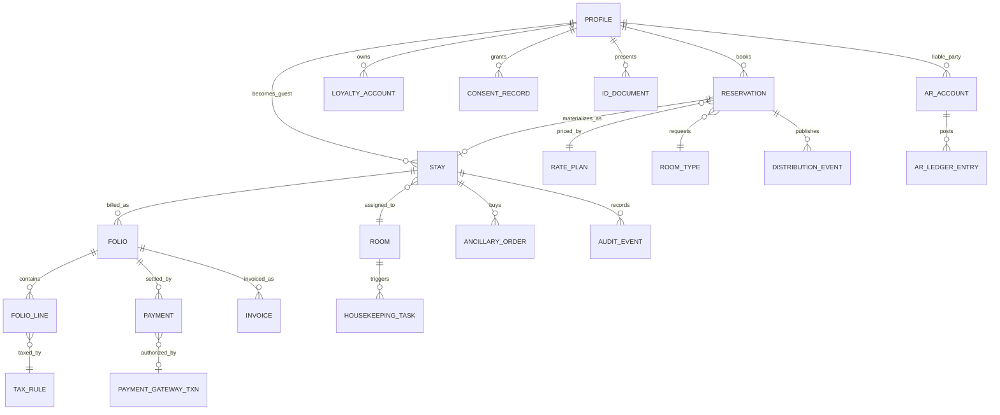

# Hotel PMS Front-Desk Features for 2026

## Executive summary

The 2026 front-desk PMS market has converged around a much broader operating model than the legacy “check-in/check-out” core. The strongest platforms now combine reservations, front office, housekeeping, payments, distribution, analytics, and increasingly AI-assisted merchandising and pricing in one operating fabric. Across official vendor documentation, the clearest recurring patterns are: cloud-native operations, open APIs and eventing, embedded or tightly integrated payments, self-service guest journeys, real-time room/inventory synchronization, and multi-property governance. Oracle OPERA Cloud, Mews, Cloudbeds, Agilysys, Infor HMS, and Stayntouch all document these trends, though with different emphases and levels of native depth. citeturn6search2turn27search3turn26search16turn35search17turn17search2turn33search0

The most important architectural finding is that a serious 2026 PMS should be designed as a **reservation-to-cash and guest-identity platform**, not merely a room-status application. Public documentation from Oracle, Infor, Stayntouch, Cloudbeds, and Mews shows the practical importance of deposit ledgers, direct bill and city ledger flows, invoice life cycles, refunds, chargebacks, group billing, and immutable or auditable financial postings. Hotels that under-design this layer usually end up with brittle folio logic, manual reconciliation, AR leakage, and inconsistent guest/account histories. citeturn8search0turn11search0turn29search5turn10search16turn6search0turn7search3

A second finding is that **front-desk UX is moving away from the fixed counter**. Mews documents kiosk, guest portal, online check-in, online ID upload, and upsell during self-service journeys; Stayntouch continues to emphasize tablet- and mobile-first front desk; Oracle documents pay-by-link and in-arrivals workflows; Cloudbeds and Agilysys increasingly position guest communication, self-service, and mobile-friendly workflows as core operational tools rather than peripheral add-ons. That implies a 2026 reference design should treat desktop, tablet, kiosk, mobile web, and staff mobile apps as first-class surfaces. citeturn31search1turn31search17turn31search11turn30search2turn30search4turn27search7turn3search5

A third finding is that AI is no longer just an external RMS adjunct. Oracle’s Nor1 materials document AI-powered personalized upsell and in-path merchandising; Mews documents AI-driven revenue management and dynamic pricing through Atomize; Cloudbeds documents AI-based forecasting, pricing recommendations, chat, and the broader Signals AI layer; Agilysys now positions AI as embedded across rooms, dining, spa, golf, and back office; Stayntouch is shipping AI guest messaging and promoting AI-linked revenue integrations. The practical implication is that AI in PMS for 2026 should focus on **high-confidence, workflow-adjacent use cases**: predictive upsell, pricing suggestions, anomaly detection, reconciliation assistance, multilingual messaging, and natural-language assistance for staff and guests. citeturn26search0turn26search4turn26search1turn26search9turn26search5turn27search2turn27search17turn27search21turn26search3turn28search9turn29search0

The baseline non-functional bar is also higher. A front-desk PMS in 2026 must be designed around PCI DSS payment protection, privacy-by-design under GDPR and PDPA-style regimes, WCAG 2.2 accessibility, RBAC, SSO, auditable change trails, encryption, and jurisdiction-aware retention/deletion. Leading vendors explicitly highlight combinations of tokenization/P2PE/PCI controls, SSO or identity controls, audit capabilities, uptime/monitoring, and privacy tooling. citeturn25search10turn24search2turn24search3turn24search0turn20search0turn20search3turn10search2turn14search1turn18search4turn19search3turn16search3

The recommended roadmap from this research is straightforward. Build the **ledger core, arrivals/departures core, guest profile core, and room/housekeeping/event core first**. Add multi-property, distribution, AR/city-ledger sophistication, BI, and staff mobility next. Reserve deep AI, NLP/voice flows, franchise policy automation, energy/IoT orchestration, and cross-property cohort intelligence for later phases, after the event model, security controls, and integration architecture are stable. That sequencing best matches both current platform maturity and implementation risk. citeturn9search1turn10search0turn19search0turn32search15turn32search1turn32search8

## Scope and methodology

This report prioritizes **primary and official sources**: vendor documentation, official help centers, vendor-owned whitepapers/datasheets, and official standards bodies. The comparison set is a **public-documentation-based sample of six leading or highly visible PMS/front-desk suites** with substantial current documentation and meaningful front-office breadth: Oracle OPERA Cloud, Mews, Cloudbeds, Agilysys Stay PMS, Infor HMS, and Stayntouch PMS. Where public documentation is silent, the report says so instead of assuming capability.

Two important caveats shape the conclusions. First, “market-leading” is treated here as a **representative leader set**, not a formal market-share ranking. Second, vendor websites vary in how deeply they expose workflows such as chargebacks, country fiscalization, or country-by-country residency controls. Public docs are strong enough to compare architectural direction, module breadth, and operational maturity, but they are not a substitute for live product validation, contract terms, or a country-specific compliance review.

## Comparative vendor analysis

The strongest public-doc evidence shows a market split between **enterprise breadth**, **cloud-native operating simplicity**, and **mobile/self-service experience strength**. Oracle and Infor document deep enterprise finance, multi-property, and central reservations patterns. Mews, Cloudbeds, and Stayntouch document stronger cloud-native mobility, self-service journeys, and API/event orientation. Agilysys stands out where PMS must interact deeply with broader resort or multi-amenity ecosystems such as POS, service workflows, and payments. citeturn32search15turn12search3turn31search9turn32search8turn30search2turn34search18

| Vendor | How public documentation shows the product is implemented | Evidence |
|---|---|---|
| **Oracle OPERA Cloud** | Very deep property and enterprise PMS model: arrivals/in-house workflows, billing windows, direct bill/city ledger settlement, profile anonymization, reporting and analytics, OHIP property/distribution/asynchronous APIs, business events, central multi-property controls, and AI-based Nor1 upsell/merchandising. | citeturn30search4turn8search0turn8search1turn9search1turn9search4turn9search10turn9search11turn32search15turn34search14turn26search0turn26search4 |
| **Mews** | Cloud-native operating system pattern: front desk, reservations, housekeeping, accounting/billing, embedded payments, payment reporting including refunds and chargebacks, guest portal and kiosk, online check-in with ID upload and registration-card steps, AI RMS/dynamic pricing, SSO, and portfolio-level multi-property controls. | citeturn6search2turn6search0turn31search1turn31search17turn31search11turn20search3turn20search0turn26search1turn26search9turn32search1turn32search9 |
| **Cloudbeds** | Unified-stack pattern: PMS + channel manager + booking engine + guest profiles + guest experience/chatbot + revenue intelligence + multi-property view + open developers platform. Public docs are especially strong on webhooks, REST/GraphQL access, guest profile/anonymization, and an immutable transaction model used as a foundation for deposits and A/R ledgers. | citeturn30search1turn35search3turn5search2turn5search16turn27search9turn27search2turn32search8turn10search0turn10search4turn10search16 |
| **Agilysys Stay PMS** | Broad hospitality-suite pattern: PMS for reservations/front desk/housekeeping/billing with open APIs and cloud/on-premise flexibility; Agilysys Pay for PCI-validated payments; Agilysys Service for housekeeping, maintenance, and guest requests; Agilysys Analyze for real-time operational analytics; and an increasingly explicit AI layer across property operations. | citeturn3search5turn17search2turn16search3turn16search6turn34search0turn34search8turn17search6turn26search3turn16search14 |
| **Infor HMS** | Classic enterprise hotel-management pattern: CRS, front desk, availability, walk-ins, group sales, rates/restrictions, A/R, direct bill/city ledger transfer, end-of-day no-show processing, audit trail, user groups/roles, and integration via web services and Databridge. Public docs expose strong operational breadth but less visible 2026-native AI or self-service content than the cloud-native challengers. | citeturn2search0turn21search2turn21search22turn11search6turn11search0turn12search3turn21search16turn18search4turn18search1turn18search11 |
| **Stayntouch PMS** | Mobile-first front-desk pattern: cloud PMS with tablet workflows, kiosk/mobile check-in and checkout, groups and billing, payment links, VCC/deposit automation, native or integrated channel management, open APIs plus webhooks, HMAC webhook signing, extensive integrations, AI guest messaging, and a security guide that explicitly discusses canary releases, audit logging, and runtime alerting. | citeturn4search0turn30search2turn4search13turn4search1turn29search10turn35search1turn19search0turn19search4turn28search9turn19search3 |

The following matrix is an **analyst synthesis from the cited documentation above**, not lab validation. “Deep” means strong native/publicly well-documented support; “Strong” means solid support but sometimes with add-ons or adjacent modules; “Lighter” means present, partner-led, or less explicit in public docs.

| Capability area | Oracle | Mews | Cloudbeds | Agilysys | Infor HMS | Stayntouch |
|---|---|---|---|---|---|---|
| Enterprise front-desk finance, folios, AR, city ledger | **Deep** | **Strong** | **Strong** | **Strong** | **Deep** | **Strong** |
| Mobile/self-service guest journey | **Strong** | **Deep** | **Strong** | **Strong** | **Lighter** | **Deep** |
| Housekeeping and task orchestration | **Strong** | **Strong** | **Strong** | **Deep** | **Strong** | **Strong** |
| OTA/GDS/direct booking and channel synchronization | **Deep** | **Strong** | **Deep** | **Strong** | **Strong** | **Strong** |
| Open APIs, events, webhooks, developer extensibility | **Deep** | **Strong** | **Deep** | **Strong** | **Strong** | **Deep** |
| Multi-property and chain controls | **Deep** | **Deep** | **Strong** | **Strong** | **Strong** | **Strong** |
| Embedded payments and payments automation | **Strong** | **Deep** | **Strong** | **Deep** | **Strong** | **Strong** |
| Native AI monetization and pricing intelligence | **Strong** | **Deep** | **Deep** | **Deep** | **Lighter** | **Strong** |

A practical reading of the market is this. If the target operating model is a large chain or highly regulated international estate with complex finance and central controls, Oracle OPERA Cloud remains the clearest public-doc benchmark. If the target is a cloud-native, self-service, high-automation guest journey with strong embedded payments and revenue optimization, Mews is the clearest reference. If the target is a unified stack for independents or groups that want PMS, distribution, marketing, AI, and open developer tools in one ecosystem, Cloudbeds is especially relevant. If the property is resort-heavy and operationally dependent on coordinated PMS+POS+service flows, Agilysys deserves serious attention. If configurability, classic CRS/A/R depth, and enterprise workflow control matter more than consumerized UX, Infor HMS still maps well. If mobile front-desk execution and rapid service mobility are the priority, Stayntouch is unusually strong in public documentation. citeturn32search15turn26search5turn10search4turn34search8turn18search4turn30search2

## Reference architecture and feature scaffolding

The recommended reference architecture below is a synthesis of common patterns evident across the six platforms and the cited standards. Three design principles stand out from the source material. First, the **financial model should be ledger-first and auditable**, with deposits, folios, invoices, direct bill/city ledger, refunds, and dispute states represented as durable business objects rather than UI shortcuts. Second, the **integration model should be event-driven**, because modern PMS ecosystems increasingly rely on APIs, business events, and webhooks for distribution, housekeeping, locks, POS, and analytics. Third, the **guest model should be profile-centric**, persisting preferences, consent, identity artifacts, loyalty, and cross-property histories in one durable guest context. citeturn8search0turn11search0turn10search16turn9search11turn10search0turn19search0turn5search2turn8search1

The table below is a **reference scaffold for a 2026 PMS/front-desk platform**, not a claim that every vendor implements every line identically. The priorities are recommended sequencing priorities for a greenfield or major-replatform program.

| Feature domain | Purpose | Roles involved | Data model sketch | UI and workflow considerations | Integration touchpoints | Security and privacy | Recommended performance target | Priority |
|---|---|---|---|---|---|---|---|---|
| **Reservations, availability, walk-ins, waitlist, cancellations, no-shows** | Maintain the single source of truth for demand and room commitment. | Reservations agent, front desk, revenue manager, call center, manager. | `Reservation`, `ReservationSegment`, `RoomType`, `AvailabilitySnapshot`, `CancellationPolicy`, `NoShowRule`, key fields: arrival/departure, room type, adults/children, market/source, rate plan, guarantee, status, channel ref. | Arrival/departure queue views, rapid walk-in flow, date-change diffing, status chips, oversell warnings, one-click reinstate. | Booking engine, OTA/GDS/channel manager, call center/CRS, RMS. | Mask payment references, log status changes, enforce who can cancel/reinstate/override oversell. | Search p95 <1s; create/update p95 <2s; oversell validation synchronous. | **MVP** |
| **Check-in, registration, e-sign, KYC, ID scanning, key issue** | Turn a reservation into an active stay with identity and payment confidence. | Front desk, self-service guest, night manager, security. | `Stay`, `RegistrationCard`, `IDDocument`, `VerificationStatus`, `ArrivalQueue`, fields: check-in time, assigned room, identity type/number, signature hash, verified-by, key count. | Support staffed, kiosk, mobile-web, and tablet check-in; exception-first UI for room not ready, failed payment, missing ID, underage/guardian rules. | ID scanner/OCR, lock or mobile-key system, payment gateway, guest messaging. | Data minimization for ID data, retention clocks, image encryption, consent capture, audit trail for manual overrides. | Check-in commit p95 <2s after dependencies return; room-ready event propagation <5s. | **MVP** |
| **Check-out, late checkout, post-stay settlement** | Close operational and financial stay state cleanly. | Front desk, self-service guest, accounting. | `Departure`, `Settlement`, `Invoice`, `LateCheckoutRule`, fields: departure time, balance, settlement method, invoice status, paid/partially paid. | Review-bill-before-close, visible routed bills, self-service checkout if balance clear, “check out with balance” only under elevated privilege. | Payment gateway, e-invoice/fiscal connector, CRM/loyalty, messaging. | Restrict checkout-with-balance, rotate invoice numbers per jurisdiction, preserve immutable invoice history. | Departure action p95 <2s; invoice generation immediate or queued <30s by jurisdiction. | **MVP** |
| **Room assignment, room moves, room status, out-of-order/out-of-service** | Match the right room to the right stay while preserving operational integrity. | Front desk, housekeeping supervisor, duty manager. | `Room`, `RoomStatus`, `RoomMove`, `MaintenanceBlock`, fields: room number, room type, status, cleanliness, inspected flag, OOO/OOS period, move reason. | Drag/drop or matrix assignment, smart suggestions, visual collisions, queueing for not-ready rooms, one-tap room swap. | Housekeeping app, maintenance/tasking, locks, energy management. | Limit who can override room blocks or swap occupied rooms; audit every move. | Matrix refresh <3s; cross-team room status sync <5s. | **MVP** |
| **Rate management, restrictions, packages, negotiated/corporate rates** | Monetize inventory without losing operational clarity. | Revenue manager, reservations, sales, finance. | `RatePlan`, `Package`, `Restriction`, `CorporateRate`, `DerivedRate`, fields: base rate, child derivation, LOS rules, CTA/CTD, currency, tax inclusivity, sell limits. | Calendar and rate-grid UX, diff preview before publish, property and portfolio scopes, what-if preview. | RMS, channel manager, booking engine, CRS, contract management. | Separate approve/publish privileges, prevent unauthorized rate disclosure, audit published changes. | Publish locally <10s; end-to-end distribution sync target <60s, alarm if >5 min. | **MVP**, with advanced automation later |
| **Upsell and ancillary sales** | Increase TRevPAR and capture high-margin demand at the right touchpoint. | Front desk, kiosk/mobile guest, revenue manager, concierge. | `AncillaryCatalog`, `Offer`, `OfferEligibility`, `CommissionRule`, `Order`, fields: offer type, inventory, price, eligibility window, fulfillment status. | In-path upsell in booking/check-in/out, frictive steps minimized, attach to stay or folio, support manual and AI-ranked offers. | PMS, RMS, POS/spa/parking/activity systems, payment gateway, concierge/chatbot. | Avoid using sensitive profile attributes in impermissible ways; expose consent/marketing basis where required. | Offer decisioning <500ms from cache for common paths; fulfillment confirmation <5s. | **MVP core**, **Advanced** for predictive ranking |
| **Groups, allotments, rooming lists, corporate accounts** | Support meetings, events, tours, contract business, and block management. | Sales, reservations, front desk, accounting. | `Group`, `Allotment`, `RoomingList`, `Pickup`, `Company`, `TravelAgent`, fields: block dates, cutoff, wash, pickup, billing rules, rooming status, voucher ref. | Dedicated group dashboard, pickup curves, rooming-list import/export, date-range billing routes, per-room or master billing. | CRS, sales & catering, accounting, channel/distribution, payment gateway. | Strong approvals for block release, billing changes, and voucher-based direct bill. | Group search p95 <1s; rooming-list import with validation and resumable errors. | **Advanced** |
| **Deposits, folios, split billing, direct bill, corporate billing, city ledger** | Handle complex hotel financial responsibility models cleanly. | Front desk cashier, accounting, AR clerk, auditor. | `DepositLedger`, `Folio`, `BillingWindow`, `RoutingRule`, `ARAccount`, `CityLedgerEntry`, fields: window number, payer, covered charge codes, due date, ledger status. | Window-based bill review, explicit routing previews, “who pays what” clarity, post-stay AR transfer controls. | Accounting/ERP, payment platform, sales/corporate account systems, POS. | Immutable posting IDs, reversals not deletions, role-gated direct bill, audit of routing edits. | Bill refresh <2s for common stays; bulk AR transfer restartable/idempotent. | **MVP** for basic folios, **Advanced** for city ledger/corporate complexity |
| **Payments, multi-currency, taxes, invoicing, refunds, chargebacks** | Collect money safely and compliantly from booking through dispute resolution. | Front desk, finance, e-commerce, AR, fraud/risk. | `PaymentIntent`, `Authorization`, `Capture`, `Refund`, `ChargebackCase`, `TaxRule`, `InvoiceDocument`, fields: method, token, currency, FX rate, tax regime, gateway refs, dispute status. | One-screen payment timeline, token-on-file reuse, incidentals auth, split payment UX, chargeback evidence assembly, jurisdiction-aware invoice preview. | Gateways/acquirers, P2PE devices, fiscal/e-invoicing, fraud tools, ERP. | PCI scope reduction, tokenization/P2PE, SCA/3DS where applicable, restricted card-data exposure, dispute access controls. | Median auth <3s subject to gateway; refunds <30s to initiate; dispute eventing asynchronous and reliable. | **MVP** for auth/capture/refund, **Advanced** for dispute automation and DCC |
| **Guest profile, CRM, loyalty, preferences, consent and privacy** | Create a durable guest 360 that improves service without violating privacy rules. | Front desk, marketing, loyalty, guest relations, DPO/privacy lead. | `Profile`, `Preference`, `LoyaltyAccount`, `StayHistory`, `ConsentRecord`, `PreferenceTag`, fields: contact data, preferences, opt-ins, tier, stay frequency, spend, DSR status. | Single unified profile card, merge/deduplicate workflow, property and portfolio views, visible consent state, preference quick-picks. | CRM/CDP, loyalty, marketing automation, guest messaging, BI. | GDPR/PDPA basis tracking, data minimization, extraction/anonymization, retention rules, merge audit. | Profile lookup p95 <1s; merge operations safe, reviewable, reversible by admin workflow. | **MVP** |
| **Housekeeping, tasking, maintenance, mobile staff apps** | Keep room readiness and service execution synchronized with front desk reality. | Housekeeping agent, housekeeping lead, engineering, front desk. | `Task`, `TaskAssignment`, `RoomReadiness`, `MaintenanceTicket`, `ServiceRequest`, fields: status, priority, SLA, room, assignee, completion time. | Mobile-first UX, glove-friendly/touch-friendly targets, offline-tolerant task updates, room-queue prioritization by imminent arrival. | PMS room status, guest messaging, engineering/CMMS, locks, energy/IoT. | Device/session controls, least privilege, location or device attestation where needed, audit all status flips. | Task propagation <5s; offline sync conflict resolution deterministic. | **MVP** |
| **Channel management, real-time inventory, OTA/GDS/direct booking, parity** | Prevent desync and convert demand profitably. | Revenue manager, e-commerce, reservations. | `Channel`, `RateMapping`, `InventoryAllocation`, `ParityRule`, `ChannelEvent`, fields: mapping IDs, restrictions, send status, pull status, reconciliation state. | Real-time sync dashboard, error queues, mapping validation, direct-vs-OTA comparison, parity exceptions visible. | Channel manager, CRS, booking engine, metasearch, GDS. | HMAC-signed webhooks, replay protection, scoped credentials per partner, change approval on mappings. | End-to-end publish target <60s; automated reconciliation every few minutes; hard alarms on inventory mismatch. | **MVP** |
| **Integrations and extensibility** | Let the PMS orchestrate the property’s wider tech estate. | IT, enterprise architect, integration engineer, vendor partners. | `Integration`, `Credential`, `WebhookSubscription`, `EventLog`, `RetryQueue`, fields: partner, auth scheme, event type, mapping version, dead-letter state. | Admin console for connection health, tenant-safe secrets, environment promotion, visible retries and dead letters. | POS, locks, access control, ERP/accounting, BI, RMS, IoT, chatbots, digital concierge, identity systems. | Secrets vaulting, mTLS/OAuth where possible, signed/outbound events, RBAC for config, data minimization per integration. | Webhook dispatch near real time; retries exponential; idempotency mandatory for financial/posting endpoints. | **MVP** |
| **Reporting, forecasting, segmentation, cohort and BI** | Turn operations data into daily control and strategic insight. | GM, revenue, finance, operations, marketing. | `FactStay`, `FactRevenue`, `FactChannel`, `GuestSegment`, `Cohort`, `ForecastSnapshot`, fields: ADR-like measures, occupancy-like measures, room nights, ancillary spend, channel mix, cohort dimensions. | Role-based dashboards, drill-down from KPI to transaction, property/portfolio filters, cohort and segmentation workspace, anomaly banners. | Warehouse/lakehouse, BI, RMS, CRM/CDP, finance systems. | Row-level security, PII-minimized analytics mart, retention boundaries between ops and marketing use cases. | Operational dashboards <5 min freshness; financial and forecast marts <15 min intraday. | **Advanced** |
| **Platform UX, accessibility, deployment, scalability, franchise controls** | Ensure the system is usable, governable, and deployable across varied estates. | Front desk, IT, franchise admin, accessibility lead, operations leadership. | `Tenant`, `Property`, `Brand`, `Role`, `FranchisePolicy`, `Environment`, fields: region, tenancy, property defaults, policy packs, locale, currency, language. | Desktop for dense cashiering, tablet for lobby mobility, mobile for staff tasks, WCAG 2.2 AA, keyboard support, large touch targets, resilient timeouts. | SSO/SCIM, MDM, observability stack, localization/fiscalization services. | SSO, MFA/passkeys, RBAC, audit logs, encryption at rest/in transit, regional data isolation, policy inheritance. | Horizontal scaling at portfolio level; graceful degradation under dependency outage; target cloud availability 99.95%+. | **MVP** for cloud/RBAC/accessibility basics; **Advanced** for franchise policy packs; **Future** for deeper regionalization automation |
| **AI, automation, QA, monitoring, reconciliation, runbooks** | Reduce manual work without compromising control. | Product, operations, finance, support/SRE, QA, revenue. | `Recommendation`, `ModelVersion`, `Anomaly`, `AutoMatch`, `SyntheticCheck`, `Incident`, fields: confidence, action taken, source signals, explanation, false-positive rate. | Staff-facing explanation panels, approve-before-publish where financial risk is high, simulation mode before autonomous actions. | RMS, CRM, messaging, payment/accounting reconciliation, observability, incident management. | Human override, prompt/data governance, red-team testing for AI, restricted training data use, clear auditability. | Recommendation generation <2 min for portfolio batches; anomaly alerts near real time; automated reconciliations hourly or better. | **Advanced** for suggestions/anomaly/recon; **Future** for NLP check-in and agentic operations |

Two implementation choices are especially important. First, model **reservation**, **stay**, **folio**, **invoice**, and **AR account** as distinct entities with explicit transitions. That is the surest way to avoid confusion around deposits, pre-stay payments, direct bill transfers, split bills, and post-stay collections. Second, unify everything around a **durable event log** so that arrivals, room-ready events, POS postings, refunds, chargebacks, and rate publishes can be replayed and reconciled after outages or partner lag. The official documentation from Oracle OHIP, Stayntouch Connect, and Cloudbeds webhooks is especially consistent with that design. citeturn8search0turn11search0turn10search16turn9search11turn19search0turn10search0

## Security, compliance, and operational reliability

A 2026 front-desk PMS should be engineered as a **regulated operations platform**. PCI DSS remains the baseline payment standard for systems that store, process, transmit, or can affect the security of payment account data. GDPR requires lawful, fair, transparent processing and pushes controllers/processors toward privacy by design and security of processing. Singapore’s PDPA remains a useful “baseline standard” reference for PDPA-style obligations in Asia. WCAG 2.2 remains the strongest public benchmark for accessibility. Leading hotel-tech vendors increasingly pair these obligations with operational controls such as tokenization, encryption, SSO, device controls, audit logging, runtime monitoring, and canary rollback. citeturn25search10turn25search12turn24search2turn24search14turn24search3turn24search15turn24search0turn20search0turn10search2turn18search4turn19search3turn16search3

A practical operations baseline should therefore include: tokenized card handling and P2PE for card-present flows where possible; SSO/SCIM/RBAC for staff identities; encrypted storage for ID artifacts and signatures; append-only or reversible-not-destructive financial history; region-aware retention rules; privacy self-service for data extraction and anonymization; signed webhooks and idempotent retries; and synthetic monitoring on the critical guest-money-room workflows. Public documentation from Cloudbeds, Mews, Stayntouch, Agilysys, and Infor shows many of these patterns in current products. citeturn10search20turn10search18turn20search3turn20search22turn19search4turn19search3turn16search3turn18search4

| Operational area | Minimum 2026 practice |
|---|---|
| **Testing and QA** | Layered test strategy: unit tests for pricing/routing/tax rules; contract tests for APIs/webhooks; workflow E2E tests for booking, check-in, room move, check-out, refund, and AR transfer; sandbox certification for locks/POS/payments; localization regression packs for invoice and tax outputs. |
| **Pre-release safety** | Feature flags for risky flows, canary rollout, fast rollback, seed data for realistic arrival/departure loads, and drift detection on configuration packs. |
| **Observability** | Business SLIs as well as technical SLIs: check-in success rate, payment auth success rate, inventory publish lag, housekeeping room-ready lag, posting failure rate, invoice generation lag, webhook dead-letter backlog, reconciliation mismatch counts. |
| **Synthetic monitoring** | Continuous robot flows for direct booking, OTA booking ingest, check-in with deposit, lock issue, POS post-to-folio, self-checkout, refund initiation, and AR transfer. |
| **Automated reconciliation** | Hourly or tighter matching of PMS postings vs gateway captures, POS checks, channel inventory snapshots, and accounting exports; unmatched items routed to queues with owner and SLA. |
| **Core runbooks** | Payment-gateway outage, lock-interface outage, channel desync/oversell, room-status sync failure, night-audit failure, invoice/fiscal service outage, SSO outage, suspected account compromise, and data-subject access/deletion requests. |
| **Human governance** | Clear escalation owner by domain: front desk, finance, revenue, housekeeping, integration/SRE, privacy/security. AI suggestions in monetary workflows should default to approve-before-publish until false-positive rates are proven. |

For deployment, the market signal is clear: new PMS investment is overwhelmingly **cloud-first**, but hybrid or on-premise considerations still matter in migration-heavy estates and properties with unusual integration or residency constraints. Oracle explicitly documents both OPERA Cloud and migration paths from OPERA 5 hosted/on-premise environments; Agilysys explicitly highlights cloud with on-premise flexibility; Infor still frames many decisions in cloud-vs-legacy terms. A modern product strategy should therefore support cloud multi-tenancy by default, with clear regional isolation and deployment hardening, while recognizing that hybrid integration patterns will persist for years. citeturn33search14turn33search19turn17search6turn17search2turn33search12turn33search15

## Recommended phased roadmap

The roadmap below assumes a **greenfield or major-replatform PMS/front-desk program**, with no mandated tech stack, aiming for enterprise-grade cloud deployment. The effort ranges are **analyst estimates**, not vendor promises. They are based on the breadth of capabilities documented in current PMS suites and the control overhead implied by PCI DSS, privacy regimes, APIs/events, and multi-property governance. citeturn25search10turn24search2turn24search3turn9search1turn10search0turn32search15turn32search1turn32search8

```mermaid
gantt
    title Recommended sequencing for a 2026 PMS front-desk platform
    dateFormat  X
    axisFormat %s
    section MVP
    Ledger core, reservations, arrivals, departures, room status, payments, RBAC, APIs :a1, 0, 12
    section Expansion
    Multi-property, distribution, AR/city ledger, housekeeping mobile, BI, revenue workflows :a2, 6, 12
    section Strategic horizon
    AI autonomy, cohort intelligence, franchise governance, IoT/energy orchestration, NLP interfaces :a3, 18, 42
```

| Phase | Scope | Estimated implementation effort | Delivery risk | Why this phase order makes sense | Exit criteria |
|---|---|---:|---|---|---|
| **MVP** | Reservations and availability; arrivals/check-in; departures/check-out; room assignment and room status; core folios and billing windows; card-on-file and basic auth/capture/refund; guest profile; RBAC/audit; webhooks/API foundation; basic housekeeping/tasking; operational dashboards. | **110–160 person-months** | **High** | This creates the reservation-to-cash and room-readiness backbone without which everything else becomes brittle. | Single-property go-live; no manual shadow ledger; consistent check-in/out flow; stable posting and invoice generation; synthetic monitors green for the core journey. |
| **Twelve to eighteen month expansion** | Multi-property view and brand policies; channel/distribution orchestration; groups/allotments; negotiated/corporate rates; AR/direct bill/city ledger depth; mobile housekeeping/engineering; self-service guest journey; richer BI; market/channel segmentation; forecast workspace; accounting exports and reconciliation queueing. | **140–220 person-months** | **High** | Complexity rises sharply once multiple properties, distribution, and post-stay collections enter the picture. | Portfolio-level operations; sub-minute inventory/rate publish target; group billing stable; hourly reconciliation in place; no uncontrolled spreadsheet dependencies. |
| **Three to five year horizon** | AI ranking for upsells and pricing suggestions; anomaly detection and automated matching; NLP staff assistant; multilingual guest messaging agent; digital concierge orchestration; IoT and energy workflows; deeper cohort analytics; franchise governance packs; selective autonomous actions with approval rules. | **220–400 person-months** over the phase | **Medium to very high**, depending on autonomy ambitions | These features require mature event data, trusted controls, and strong explainability. Implementing them too early creates failure cascades and governance debt. | Model governance and explanation layer working; measurable labor savings and revenue lift; autonomous actions limited to low-risk domains until proven; cross-property intelligence trusted by finance and operations. |

The largest risks in practice are not usually screen-building. They are **financial edge cases, partner synchronization, configuration sprawl, and privacy scope creep**. Direct bill routing, refunds/chargebacks, tax localization, group billing, room-status desynchronization, oversell recovery, and identity/consent handling create the hardest defects because they cut across departments and external systems. That is why the roadmap deliberately places eventing, immutable finance, and operational observability ahead of advanced AI autonomy. citeturn8search0turn11search0turn10search16turn35search3turn19search4turn24search2turn25search10

The best near-term build strategy is therefore:

1. **Build the core ledger and workflow engine first.**  
2. **Standardize events and retries before multiplying integrations.**  
3. **Treat self-service and tablet mobility as native workflows, not UX garnish.**  
4. **Keep AI assistive before it becomes autonomous.**

Those four choices align most closely with how the current leading PMS products appear to be investing. citeturn9search11turn10search0turn30search2turn31search9turn26search5turn27search17

## Open questions and limitations

This comparison is deliberately grounded in public/official materials, so several areas remain only partially resolvable without hands-on product validation or contract review. Public documentation is uneven on country-by-country data residency options, tax fiscalization depth outside highlighted jurisdictions, chargeback/dispute automation depth, offline survivability during lengthy lock/payment outages, and the exact boundaries between native functionality and marketplace/partner functionality for some vendors.

The six-vendor set is representative rather than exhaustive. It excludes several credible PMS players because the report prioritized breadth of official documentation and front-desk relevance over exhaustively surveying the full market.

Finally, the implementation-effort figures are planning estimates. They should be re-based during architecture discovery once the intended property types, jurisdiction mix, migration depth, integration count, and target operating model are known.