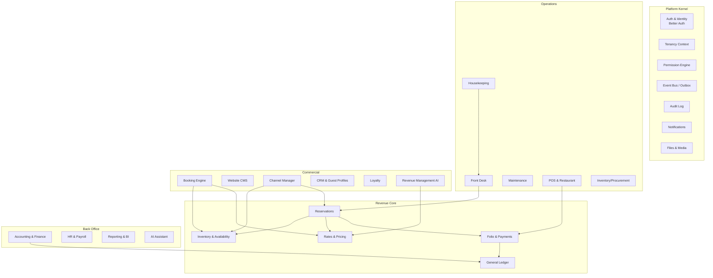
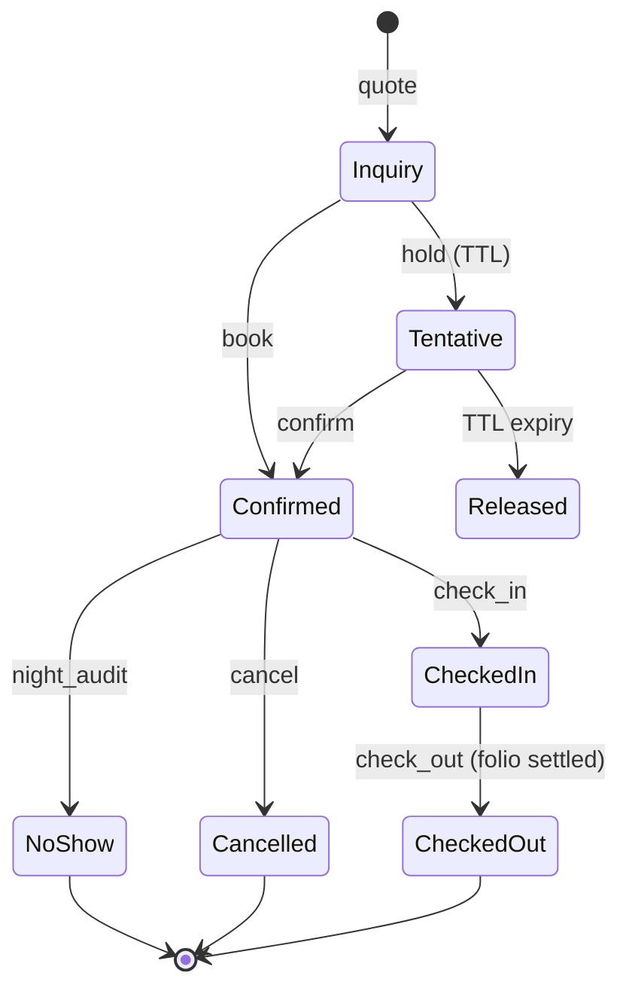

# 04 — System Architecture

> **One deployable. Eighteen modules. Zero sync lag.**
> A modular monolith on NestJS/Fastify that is structurally ready for service extraction — but never forced into it prematurely.

---

## 1. Architectural Thesis

The fragmented hospitality stack (separate PMS, POS, accounting, booking engine, CRM, HR) fails because **integration is where hotel software goes to die**: middleware crashes drop room charges, channel sync lag causes overbookings, and nightly batch exports make accounting perpetually stale. Research confirms the 30–90 second OTA sync window is a structural cause of double-bookings, and PMS↔POS middleware outages are a top operational complaint at full-service properties.

Our answer is architectural, not feature-based: **every module reads and writes the same transactional core**. A restaurant check posting to a guest folio is a single ACID transaction, not an interface message. The booking engine reads the same availability counters the front desk writes. Accounting entries are generated in the same transaction as the business event that caused them.

### Why modular monolith (not microservices)

| Concern | Microservices | Modular Monolith (chosen) |
|---|---|---|
| Folio + POS check posting | Saga/2PC across services — exactly the failure mode we're eliminating | Single ACID transaction |
| Team size (V1: 6–15 engineers) | Operational overhead dominates | One deploy pipeline, one on-call |
| Latency budget (sub-second UX) | Network hops + serialization on every cross-domain call | In-process calls |
| Tenant isolation | Replicated per service | Enforced once at the data layer (RLS) |
| Future scale | — | Extraction-ready seams (below) |

Mews, Cloudbeds, and Shopify all run (or ran for years) on monolithic cores. OPERA Cloud's microservice re-platforming is precisely what made it slow and expensive. We take the monolith with discipline.

### Extraction-readiness rules (enforced from day one)

1. **Each module owns its tables.** No module touches another module's tables directly — not even SELECT. ESLint boundary rules + schema-per-module conventions enforce this at CI.
2. **Cross-module reads** go through the owning module's public TypeScript API (a NestJS exported provider) or a materialized read model.
3. **Cross-module writes never happen.** State changes in another domain are requested via the owning module's API (sync, same transaction when required — e.g., POS→Folio) or reacted to via domain events (async).
4. **Domain events are the only async coupling.** Every event flows through the transactional outbox (§4).
5. **No shared mutable singletons** outside the platform kernel (auth context, tenancy context, event bus, audit).

First extraction candidates when scale demands: channel-manager sync workers, notification dispatch, AI inference, report generation. Each already communicates only via events + REST, so extraction is a deployment change, not a rewrite.

---

## 2. Module Map



**Dependency direction is law:** Commercial and Operations depend on the Revenue Core; the Revenue Core depends only on the Kernel; nothing depends on Back Office read models. Cycles are a CI failure.

### The Revenue Core (the part everyone gets wrong)

Five modules form the transactional heart and must always live in the same database transaction scope:

| Module | Owns | Key invariant |
|---|---|---|
| **Inventory & Availability** | Room types, rooms, availability counters, allotments | `sold + blocked ≤ physical + overbook_limit` per room type per date — enforced by counter updates, never by scanning reservations |
| **Rates & Pricing** | Rate plans, daily prices, restrictions, packages, taxes | Every sellable price is resolvable in one indexed lookup |
| **Reservations** | Reservation lifecycle, groups, blocks | State machine (§5); every state change emits an event |
| **Folio & Payments** | Folios, charges, payments, refunds, deposits | Folio balance = Σ postings; postings are immutable (corrections are reversals) |
| **General Ledger** | Journal, accounts, cost centers, business dates | Every financial posting generates balanced journal lines in the same transaction |

This is the structural answer to "no synchronization lag": the booking engine, channel manager, front desk, and POS all converge on these five modules in-process.

---

## 3. Runtime Topology

```
                        ┌────────────────────────────────────────┐
                        │                CloudFront CDN          │
                        └───────┬─────────────────────┬──────────┘
                                │                     │
                  ┌─────────────▼──────────┐  ┌───────▼─────────────┐
                  │  Next.js apps (web,    │  │  Booking engine +   │
                  │  pos, guest, admin)    │  │  CMS sites (ISR)    │
                  └─────────────┬──────────┘  └───────┬─────────────┘
                                │      REST + WS      │
                        ┌───────▼─────────────────────▼──────────┐
                        │   API Gateway (ALB) → NestJS/Fastify   │
                        │   ┌──────────┐ ┌──────────┐            │
                        │   │ api pods │ │ ws pods  │  (same     │
                        │   └──────────┘ └──────────┘   image)   │
                        │   ┌──────────────────────┐             │
                        │   │ worker pods (queues, │             │
                        │   │ outbox relay, cron)  │             │
                        │   └──────────────────────┘             │
                        └───────┬──────────┬──────────┬──────────┘
                                │          │          │
                     ┌──────────▼───┐ ┌────▼────┐ ┌───▼────────┐
                     │ PostgreSQL   │ │  Redis  │ │ OpenSearch │
                     │ (primary +   │ │ cache + │ │ search +   │
                     │  replicas)   │ │ streams │ │ analytics  │
                     └──────────────┘ └─────────┘ └────────────┘
```

**One container image, three roles** (`api`, `ws`, `worker`) selected by env var. This keeps the monolith's deployment simple while letting each role scale independently on Kubernetes HPA:

- **api** — stateless REST; scales on CPU/RPS.
- **ws** — Socket.IO with Redis adapter; sticky sessions via ALB; scales on connection count.
- **worker** — BullMQ consumers, outbox relay, night audit, channel sync, report generation; scales on queue depth.

### Data stores and their jobs

| Store | Used for | Never used for |
|---|---|---|
| **PostgreSQL** | All system of record data; RLS tenant isolation; transactional outbox | Search ranking, hot counters with >1k writes/s |
| **Redis** | Cache (availability grids, permission decisions, rate lookups), BullMQ queues, Redis Streams (event transport), Socket.IO pub/sub, rate limiting, idempotency keys | Anything that must survive total loss |
| **OpenSearch** | Global search (guests, reservations, invoices), log analytics, BI aggregations over event projections | System of record |

---

## 4. Event Architecture

### Transactional outbox (the only way events leave a module)

```
BEGIN;
  UPDATE reservations SET status = 'checked_in' ...;
  INSERT INTO folio_postings ...;
  INSERT INTO outbox_events (id, tenant_id, aggregate_type, aggregate_id,
                             event_type, payload, occurred_at)
  VALUES (uuidv7(), ..., 'reservation', $1, 'reservation.checked_in', $2, now());
COMMIT;
-- Outbox relay (worker) reads new rows, publishes to Redis Streams,
-- marks published. At-least-once; consumers are idempotent.
```

Why outbox over direct publish: an event published after commit can be lost on crash; published before commit can describe a rolled-back change. The outbox makes the business change and its event **atomically inseparable** — non-negotiable for financial events.

### Event taxonomy

`<aggregate>.<past-tense-verb>`, versioned payloads (`v` field), envelope carries `tenant_id`, `property_id`, `actor`, `correlation_id`, `causation_id`.

Representative events:

```
reservation.created / .modified / .cancelled / .checked_in / .checked_out / .no_show
room.status_changed            housekeeping.task_completed
folio.charge_posted / .payment_recorded / .refunded / .closed
pos.check_opened / .check_closed / .check_voided
rate.price_changed             availability.changed
guest.profile_merged           channel.reservation_received
gl.journal_posted              nightaudit.completed
employee.shift_started         invoice.issued / .paid
```

### Consumers

- **Internal projections** — read models (BI aggregates, OpenSearch indexing, dashboard counters).
- **Channel manager push** — `availability.changed` / `rate.price_changed` trigger delta pushes to OTAs (target: <5s from change to OTA push, vs the industry's 30–90s).
- **Webhooks** — tenant-registered endpoints ride the same stream (see `08-api-standards.md`).
- **Realtime UI** — events fan out via Socket.IO rooms scoped `tenant:{id}:property:{id}:{topic}` so a front-desk screen sees a new OTA booking the moment it lands.
- **Notifications** — guest/staff messaging rules.

Redis Streams with consumer groups gives ordering per stream, replay, and pending-entry recovery. When extraction or volume demands, transport swaps to SNS/SQS or Kafka behind the same `EventBus` interface — consumers don't change.

---

## 5. The Reservation State Machine (canonical example of module design)



Every transition: (1) validates permission (`reservation.check_in` etc.), (2) runs in one transaction touching availability counters + folio as needed, (3) appends to the audit log, (4) writes an outbox event. All modules follow this same pattern — explicit state machines, transactional invariants, evented side effects.

---

## 6. Request Anatomy (every API call)

```
1. Edge: CloudFront → ALB → Fastify
2. Auth: Better Auth session/API key → user identity
3. Tenancy: resolve {tenant_id, property_id} from token + X-Property-Id header;
   open txn-scoped Postgres session with SET LOCAL app.tenant_id / app.property_id
   → RLS active for every query in the request
4. Permission: PermissionGuard checks required permission(s) against the
   cached decision set for {user, tenant, property} (Redis, ~0.2ms)
5. Validation: Zod schema (shared package, same schema validates the
   frontend form and the API boundary)
6. Handler: module service, single transaction
7. Outbox + audit rows in the same transaction
8. Response envelope + ETag; events fan out async
```

Contexts (`tenant_id`, `property_id`, `user_id`, `role_ids`, `correlation_id`) ride AsyncLocalStorage — no parameter drilling, no chance of forgetting tenant scope.

---

## 7. Frontend Architecture

- **Apps:** `web` (staff PMS — the flagship), `pos` (touch-first terminal app, offline-capable PWA/Electron), `guest` (guest portal/app), `booking` (booking engine widget + hosted flow), `sites` (CMS-rendered hotel websites, Next.js ISR), `admin` (platform back office).
- **State:** TanStack Query is the source of truth for server state (normalized keys `[tenant, property, resource, params]`); Zustand only for ephemeral UI state (command palette, selection, drawer stacks). No global client cache of business data beyond Query's.
- **Realtime:** Socket.IO events invalidate or patch Query caches — the room rack updates without polling.
- **Forms:** React Hook Form + shared Zod schemas from `packages/contracts` — validation parity between client and server by construction.
- **Optimistic UX:** mutations apply optimistically with rollback for front-desk-critical flows (room move, status change) to deliver the "Linear feel" (see `13-ux-strategy.md`).

## 8. Offline Strategy (scoped honestly)

| Surface | Offline promise | Mechanism |
|---|---|---|
| POS terminal | Full check lifecycle offline (open, fire, close to cash; card/room-charge queued) | Local SQLite/IndexedDB ledger of operations; replay queue with server-side idempotency keys; conflicts resolved by server rules (e.g., folio closed → route to AR review) |
| Staff mobile (housekeeping) | Task list + status updates offline | Same op-queue pattern, last-write-wins on task status with audit |
| PMS web | Read-only degradation (cached rack/arrivals) | Service worker cache; writes disabled offline |
| Booking engine | None (online-only by definition) | — |

This is deliberately narrower than "fully offline PMS" — full offline reservation mutation would require CRDT-grade conflict resolution against availability counters, which no competitor solves correctly either. POS offline is the operationally critical case (a restaurant cannot stop serving when Wi-Fi blips), so it gets first-class treatment.

## 9. Search Architecture

- OpenSearch indexes are **projections built from domain events** (guest profiles, reservations, invoices, POS checks, CMS content), per-tenant filtered at query time by a mandatory `tenant_id` term filter injected server-side.
- Global search ( `⌘K` ) hits one `/search` endpoint that fans into typed indices and ranks across them.
- Availability search does **not** use OpenSearch — it's pure Postgres counters + Redis cache (correctness over recall).

## 10. Multi-Region & Residency Posture

V1: single region (us-east-1 or eu-central-1 per deployment), multi-AZ everything. The tenancy model keys every row by `tenant_id`, so future **cell-based architecture** (EU cell, US cell, APAC cell — each a full stack; tenants pinned to a cell) is a routing problem, not a data-model problem. This is how we answer GDPR residency and OPERA-class enterprise RFPs without premature global complexity.

---

## Related documents

- Tenancy details: [05-multi-tenancy.md](05-multi-tenancy.md)
- Permission engine: [06-permission-engine.md](06-permission-engine.md)
- Schema and ERD: [07-database-design.md](07-database-design.md)
- API/webhook standards: [08-api-standards.md](08-api-standards.md)
- Module specs: [modules/](modules/)
