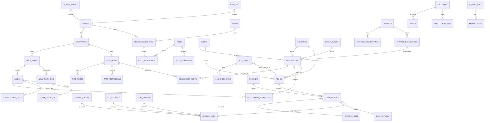

# 07 — Database Design

> PostgreSQL is the single system of record. Redis accelerates it. OpenSearch projects it. Nothing else ever owns truth.

---

## 1. Conventions

| Concern | Convention |
|---|---|
| Naming | `snake_case`; tables plural (`reservations`); join tables `a_b` (`reservation_rooms`); no abbreviations except industry-standard (`adr`, `ari`) |
| Primary keys | `uuid` v7 (time-ordered → index-friendly inserts, no hotspot, safe to expose) |
| Tenancy | `tenant_id uuid NOT NULL` on every tenant-scoped table; `property_id` where property-scoped; both lead composite indexes; RLS forced (see `05-multi-tenancy.md`) |
| Time | `timestamptz` always; **business date** (`stay_date`, `business_date`) is `date` and distinct from clock time — hotels roll the business day at night audit, not midnight |
| Money | `numeric(14,4)` + `currency char(3)`; never floats; amounts stored in transaction currency with `base_amount` + `fx_rate` snapshot for the property's base currency |
| Soft delete | Only where domain requires recoverability (`deleted_at`); financial rows are **never** deleted or updated — corrections are reversal rows |
| Audit columns | `created_at`, `created_by`, `updated_at`, `updated_by` on mutable tables |
| Enums | Postgres enums for closed domain sets (`reservation_status`); lookup tables for tenant-extensible sets (room status taxonomy, charge codes) |
| Migrations | Forward-only, transactional, generated + hand-reviewed SQL; `CONCURRENTLY` for index builds; every migration must pass the RLS-coverage CI check |

ORM stance: **Drizzle** (SQL-first, types from schema, no runtime magic) for module repositories; raw SQL for hot paths (availability, ledger) and reporting. No lazy-loading ORM patterns — every query is explicit.

---

## 2. Core ERD

Entity detail lives in each module spec; this is the cross-module spine.



### Load-bearing design decisions

**Availability is a counter table, not a query.**
```sql
CREATE TABLE availability_days (
  tenant_id uuid NOT NULL, property_id uuid NOT NULL,
  room_type_id uuid NOT NULL, stay_date date NOT NULL,
  physical int NOT NULL, out_of_order int NOT NULL DEFAULT 0,
  sold int NOT NULL DEFAULT 0, blocked int NOT NULL DEFAULT 0,  -- group holds
  overbook_limit int NOT NULL DEFAULT 0,
  PRIMARY KEY (tenant_id, property_id, room_type_id, stay_date),
  CHECK (sold + blocked <= physical - out_of_order + overbook_limit)
);
```
Booking = `UPDATE ... SET sold = sold + 1 WHERE <pk range>` inside the reservation transaction; the CHECK constraint is the last-line overbooking guard, contention is per room-type-date row (fine even at scale), and availability search is a pure indexed range read. This single decision is why the booking engine and channel manager can promise real-time truth.

**Reservations are split into header + nights + room-stays.** `reservation_nights` (one row per stay date: rate plan, price, market segment snapshot) makes pricing auditable per night and rate changes mid-stay natural. `reservation_room_stays` (room, date-range) makes room moves first-class history instead of overwriting a column.

**Folio postings are immutable; ledger is double-entry.**
```sql
CREATE TABLE folio_postings (
  id uuid PRIMARY KEY, tenant_id uuid NOT NULL, property_id uuid NOT NULL,
  folio_id uuid NOT NULL, business_date date NOT NULL,
  charge_code_id uuid NOT NULL, description text NOT NULL,
  amount numeric(14,4) NOT NULL, currency char(3) NOT NULL,
  base_amount numeric(14,4) NOT NULL, fx_rate numeric(12,6) NOT NULL DEFAULT 1,
  quantity numeric(10,3) NOT NULL DEFAULT 1,
  source_type text NOT NULL,           -- 'room', 'pos_check', 'payment', 'adjustment', ...
  source_id uuid,                      -- e.g. pos_check_id
  reverses_posting_id uuid REFERENCES folio_postings(id),
  posted_by uuid NOT NULL, posted_at timestamptz NOT NULL DEFAULT now()
) PARTITION BY RANGE (business_date);
```
Every posting generates balanced `journal_lines` in the same transaction (e.g., room charge: DR Guest Ledger / CR Room Revenue + CR Tax Payable). The guest ledger, city ledger (AR), and deposit ledger are GL control accounts — trial balance equals operational truth by construction. Full chart design in [modules/05-accounting-finance.md](modules/05-accounting-finance.md).

**Guests are deduplicated, mergeable CRM entities.** `guests` + `guest_identifiers` (email/phone/document hashes for match candidates) + `guest_merges` history (reversible pointer remap). PII columns are encrypted at the application layer (see `09-security.md`).

---

## 3. Indexing Strategy

Principles: index for the access path, lead with tenancy, prefer covering (`INCLUDE`) indexes for list screens, partial indexes for hot states.

Representative set:

```sql
-- Arrivals/departures/in-house boards (front desk's bread and butter)
CREATE INDEX res_arrivals ON reservations (tenant_id, property_id, arrival_date)
  INCLUDE (status, guest_id, room_type_id) WHERE status IN ('confirmed','checked_in');
CREATE INDEX res_departures ON reservations (tenant_id, property_id, departure_date)
  WHERE status = 'checked_in';

-- Availability & rate lookup (booking engine hot path)
-- availability_days PK already optimal; rates:
CREATE INDEX rate_prices_lookup ON rate_prices
  (tenant_id, property_id, rate_plan_id, room_type_id, stay_date) INCLUDE (price);

-- Open folios by guest/room; postings by folio
CREATE INDEX folio_open ON folios (tenant_id, property_id, status) WHERE status = 'open';
CREATE INDEX postings_by_folio ON folio_postings (tenant_id, folio_id, business_date);

-- Outbox relay (global, tiny hot set)
CREATE INDEX outbox_unpublished ON outbox_events (created_at) WHERE published_at IS NULL;

-- Housekeeping board
CREATE INDEX hk_open_tasks ON housekeeping_tasks (tenant_id, property_id, status, due_date)
  WHERE status != 'done';
```

Governance: `pg_stat_statements` reviewed in weekly perf triage; every new list endpoint ships with an `EXPLAIN` check in its PR; unused-index report monthly. Target: p99 < 50ms for all single-entity reads, < 200ms for boards/lists at 1M-reservation tenants.

## 4. Partitioning Strategy

| Table | Scheme | Why |
|---|---|---|
| `folio_postings`, `journal_lines` | RANGE by `business_date`, monthly | Append-heavy, time-pruned queries, archival by detach |
| `audit_log`, `outbox_events` | RANGE monthly | Same; outbox partitions dropped after retention |
| `availability_days`, `rate_prices`, `rate_restrictions` | RANGE by `stay_date`, quarterly | Bounded horizon (≤ 2 years future); old partitions dropped |
| `pos_check_items`, `timeclock_entries` | RANGE monthly when volume demands | Deferred until needed; designed for it (date in PK) |
| `reservations` | **Not partitioned** initially | Cross-date access patterns dominate; revisit at ~50M rows |

Partition management is a scheduled worker job (create N ahead, detach/archive expired to S3 via `pg_dump`/parquet export). No tenant-based partitioning — tenant pruning comes from indexes; date partitioning solves the actual growth axis.

## 5. Audit Strategy

Two complementary layers:

1. **`audit_log` (who did what):** every mutating API call writes `{tenant_id, property_id, actor_id, action, entity_type, entity_id, before, after, reason?, ip, correlation_id}` — same transaction as the change. Partitioned monthly, retained ≥ 7 years (financial-grade), queryable in-app (`auditlog.view`) and mirrored to OpenSearch for investigation.
2. **Domain history tables (what changed, business-meaningfully):** `room_status_log`, `reservation_status_log`, `rate_price_history`, `guest_merges` — these power product features (timeline on a reservation), not just compliance.

Immutables (`folio_postings`, `journal_lines`) need no audit shadow — they *are* the audit.

## 6. PostgreSQL Topology & Operations

- **Aurora PostgreSQL** (or RDS Multi-AZ to start): writer + ≥2 readers. Read-routing is explicit per query-site (`db.read()` vs `db.write()`), never automatic — booking-path reads (availability check before write) go to the writer to avoid replica-lag anomalies; boards, reports, exports go to readers.
- **PgBouncer (transaction mode)** in front; `SET LOCAL` tenancy is transaction-scoped so pooling is safe.
- Reporting/BI heavy queries hit a dedicated reader with its own pool + lower priority; nightly snapshot to the analytics pipeline (see `modules/11-reporting-bi.md`).
- Backups: continuous WAL (PITR ≤ 5 min RPO) + daily snapshots, cross-region copies; quarterly restore drills (untested backups are decoration).
- Version policy: stay within one major of latest PG; logical-replication-based upgrades.

## 7. Redis Usage Map

| Use | Pattern | Notes |
|---|---|---|
| Availability/rate cache | `t:{}:p:{}:avail:{roomtype}:{month}` hash, TTL 60s + event-driven bust on `availability.changed` | Booking-engine read path; DB remains authority at write time |
| Permission decision sets | `perm:{tenant}:{user}` TTL 15m + targeted bust | See 06 |
| Sessions (Better Auth) | session store | |
| Queues | BullMQ (channel pushes, emails, reports, night audit steps) | Per-tenant weighted |
| Event transport | Redis Streams + consumer groups | Outbox relay → streams |
| Socket.IO | pub/sub adapter | |
| Rate limiting / idempotency | token buckets; `idem:{key}` SETNX TTL 24h | |

Redis is **always reconstructible** from Postgres; cold-start warms caches lazily. Cluster mode when >1 node needed; keys are tenant-prefixed for slot locality.

## 8. OpenSearch Usage Map

- **Indices (projections from events):** `guests`, `reservations`, `invoices`, `pos_checks`, `cms_content`, `audit` — each document carries `tenant_id`; server injects tenant filter; aliases per index version for zero-downtime reindex.
- **Global search:** one endpoint, multi-index `msearch`, typed ranking (guest name match > reservation ID match > note content).
- **BI layer:** event-projected daily aggregates (occupancy, ADR, RevPAR, outlet revenue per business date) indexed for dashboard speed; heavy ad-hoc analytics run on the PG reader / future warehouse, not OpenSearch.
- Rebuildable at any time by replaying projections from Postgres — OpenSearch loss is degradation, not data loss.

---

Related: [05-multi-tenancy.md](05-multi-tenancy.md) · [modules/05-accounting-finance.md](modules/05-accounting-finance.md) · [12-performance-scalability.md](12-performance-scalability.md)
