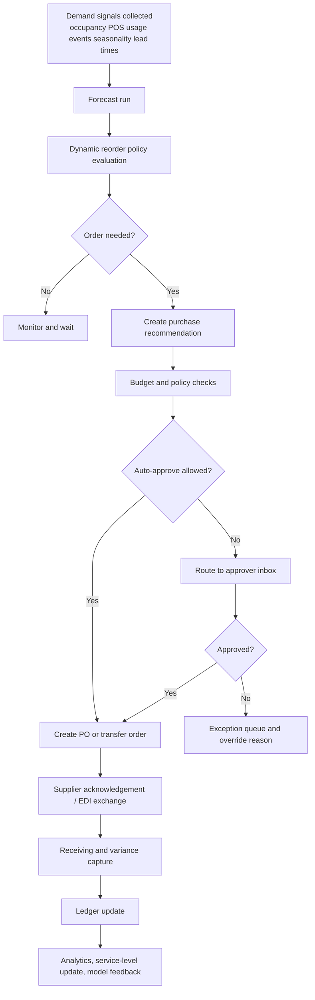
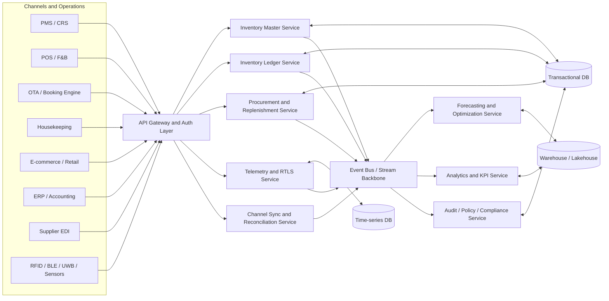
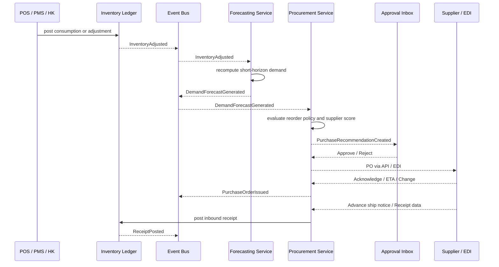

# Projected Evolution of PMS Inventory Management for 2026

## Executive summary

Hospitality PMS inventory management is moving from a narrow “stock room” function to a unified operational control layer that connects room and package availability, consumables, movable assets, procurement, POS/F&B usage, housekeeping, payments, and partner channels. Across Oracle, Amadeus, Cloudbeds, and Infor, the common direction is clear: open APIs, real-time integrations, AI-assisted decisioning, and a shared data foundation that reduces silos between commercial and operational systems. Oracle emphasizes procurement, cost control, and streaming or asynchronous APIs; Amadeus emphasizes centralized rates, inventory, availability, and service optimization; Cloudbeds emphasizes unified platform data, open APIs, broad ecosystem reach, channel synchronization, and embedded AI; Infor emphasizes cloud-native operations, AI-powered insights, and agentic orchestration over existing systems. citeturn25view0turn25view1turn30view0turn30view1turn24view6turn25view2turn27view0turn27view1turn28view1turn28view2

For a next-generation PMS module, the highest-confidence 2026 design thesis is this: **inventory should be modeled as one event-driven platform with multiple inventory classes**, not as separate subsystems. The four classes worth supporting from day one are sellable inventory (rooms, rate-linked attributes, packages, outlets, event space), consumable inventory (amenities, minibar, F&B ingredients, cleaning supplies), movable asset inventory (linen, housekeeping tools, engineering equipment, loaner devices), and service-capacity inventory (housekeeping slots, maintenance windows, outlet production capacity). This recommendation follows directly from the way major vendors are collapsing operational and commercial data into centralized reservation, distribution, PMS, POS, and service-optimization stacks. citeturn29view2turn29view3turn30view7turn24view7turn28view0

The most important implementation priorities are not the most glamorous ones. A durable foundation should come first: a canonical item and asset master, an immutable inventory ledger, warehouse and location modeling, approval and audit controls, a rules engine, API-first integrations, and channel-safe synchronization. On top of that foundation, the next layer should add AI-driven demand forecasting, supplier scoring, dynamic reorder points, multi-warehouse optimization, and exception workflows. IoT tracking, geofencing, tag battery health, and agentic workflow assistants should follow once the transactional core is stable. That sequencing matches both vendor maturity and the academic literature, which shows strong benefits from combining real-time digital supply data with ML forecasting and optimization, but also highlights privacy, cost, and operational-adoption constraints for IoT-heavy deployments. citeturn9search23turn9search0turn9search21turn8search10turn8search1turn8search4

A practical target architecture for 2026 is therefore a **microservice-oriented, event-driven, multi-tenant inventory platform** with an append-only ledger, transactional APIs, streaming events, time-series telemetry ingestion, and analytics-ready materialized views. Security should be designed around zero trust, API-specific controls, strong auditability, tokenized payment handling, GDPR-style data minimization, and CI/CD supply-chain security. citeturn20search0turn20search4turn18search10turn19search1turn20search5

## Where PMS inventory is going in 2026

The strongest near-term trend is the shift from siloed hotel systems to **open operational platforms**. Oracle’s Hospitality Integration Platform explicitly positions PMS and POS integrations as a cloud platform with open APIs, self-service registration, and more than 2,000 prebuilt integration recipes; Amadeus describes ACRS as a unified, open, scalable architecture for hotel data; Cloudbeds frames the modern hotel stack as a unified platform with open APIs plus hundreds of integrations and OTA connections; Infor emphasizes cloud-native integrations across PMS, housekeeping, maintenance, guest services, and AI-enabled cloud platforms. citeturn30view0turn25view2turn27view7turn27view8turn28view1turn24view5

The second major trend is that **AI is shifting from analysis to execution**. Phocuswright’s 2025 and 2026 public summaries argue that generative and agentic AI are changing both travel shopping and how travel companies operate; Deloitte’s 2026 outlook also identifies generative AI as one of the defining forces reshaping travel. On the vendor side, Cloudbeds markets Signals as an AI model built for hospitality forecasting and workflow automation, and its 2026 release notes show “Ask Signals” moving from query to recommendation. Infor’s 2026 hospitality writing goes further, describing agentic platforms that can connect to PMS, RMS, POS, and sales systems by API registration rather than custom code. citeturn22search1turn22search4turn24view3turn27view1turn27view2turn28view2

The third trend is **multi-channel, real-time inventory synchronization**. Oracle’s distribution APIs let authorized partners access availability and pricing to create and update reservations. Amadeus’ iHotelier materials emphasize near-real-time room updates to Booking.com and Expedia and centralized control of availability, rates, and inventory. Cloudbeds emphasizes real-time availability synchronization across OTAs and direct channels and positions disconnected systems as a source of overbooking risk. In practical terms, this means that a 2026 inventory module must support not only internal stock truth, but also external synchronization safety with idempotency, race-condition management, reservation holds, versioning, and reconciliation queues. citeturn30view2turn24view6turn29view3turn24view7turn27view3turn27view8

The fourth trend is **predictive procurement and dynamic replenishment**. Oracle’s hospitality materials control system already exposes real-time stock, order proposals, supplier assessment, purchase-order transmission, and authorization workflow. Academic synthesis is moving in the same direction: recent reviews find that machine learning and deep learning are becoming central to demand forecasting, dynamic reorder-point adjustment, inventory allocation, and supplier selection under uncertainty. Recent patent literature is also directionally consistent, with filings describing multi-channel demand planning, hierarchical ML-based supplier assessment, and sensor-driven automated replenishment based on measured consumption. Patents do not prove mainstream adoption, but they are good leading indicators for feature direction and platform defensibility priorities. citeturn25view0turn25view1turn9search23turn9search0turn9search21turn9search5turn32view0turn32view1turn32view2

The fifth trend is **IoT-enabled operational visibility**, especially for high-friction hotel operations such as housekeeping, linen circulation, engineering tools, and guest-request delivery. Amadeus’ HotSOS and TraknProtect integration shows a concrete hospitality use case: staff can see both the request and the nearest resource inventory in real time. The academic side supports the enabling technologies: IoT and AI are increasingly used in hospitality and warehouse contexts for real-time data capture, operational efficiency, localization, and automated control, while newer RFID research is improving the feasibility of passive, lower-maintenance deployments. Patent literature adds additional signal around RFID/barcode hybrid tagging, sensor-equipped tags, environmental-status sensing, tamper detection, location/routing, battery-powered asset tags, and automated replenishment sensors. citeturn29view0turn8search1turn8search4turn23search0turn23search1turn8search25turn32view4turn33view1turn33view2turn33view3

The final trend is **cost discipline under uncertain demand**, not just growth-at-all-costs automation. Deloitte’s 2026 travel outlook shows signs of more conservative spending, especially among higher-income and frequent corporate travelers, which means hotel operators will need better control over stock, wastage, labor efficiency, and upsell profitability. That makes procurement optimization, stock variance detection, and scenario planning more valuable than “smart” features that do not materially improve margins or service levels. citeturn24view3

The following table summarizes the most relevant 2026 trend signals and the direct design implication for your module.

| Trend signal | Evidence | Design implication |
|---|---|---|
| Open, API-first PMS ecosystems | Oracle OHIP promotes open APIs, self-service app registration, and 2k+ recipes; Amadeus describes open, scalable ACRS; Cloudbeds and Infor both emphasize extensible unified platforms. citeturn30view0turn25view2turn27view7turn28view1 | Make inventory a first-class platform service with stable REST APIs, events, and webhook subscriptions. |
| AI becomes operational | Phocuswright and Deloitte point to GenAI and agentic change in travel operations; Cloudbeds and Infor both market action-oriented AI. citeturn22search1turn22search4turn24view3turn27view2turn28view2 | Support decision recommendations, human approval, and later autonomous execution. |
| Real-time channel synchronization | Oracle Distribution APIs, Amadeus iHotelier, and Cloudbeds all emphasize live or near-real-time sync. citeturn30view2turn24view6turn24view7turn27view8 | Build versioned availability snapshots, reservation holds, and a reconciliation engine. |
| Predictive replenishment | Oracle order proposals and approvals; academic work on ML forecasting, dynamic reorder points, and supplier ML; patents on multi-channel demand and consumption-based ordering. citeturn25view0turn25view1turn9search23turn9search0turn9search5turn32view0turn32view2 | Model forecast runs, reorder policies, supplier scores, and recommendation objects as native entities. |
| IoT and RTLS for operational inventory | Amadeus HotSOS/TraknProtect, IoT hospitality research, RFID and tag patents. citeturn29view0turn8search1turn23search1turn32view4turn33view2 | Treat telemetry, zones, battery state, and alerting as first-class platform concerns, not side tables. |
| Security, privacy, and API compliance become foundational | GDPR, PCI DSS, OWASP API Top 10, NIST zero trust and CI/CD supply-chain guidance. citeturn19search1turn18search10turn20search4turn20search0turn20search5 | Build privacy controls, tokenization, RBAC/ABAC, audit trails, API protection, and SBOM/provenance into the core architecture. |

## Functional scaffold by technological domain

A strong scaffold should organize features by domain, but those domains should still share one ledger and one master-data backbone. The table below gives a detailed functional scaffold that is implementable without hard-wiring you to any single vendor model.

| Domain | Core features to implement | Primary entities | High-value APIs | Key domain events |
|---|---|---|---|---|
| AI-driven predictive procurement | Demand forecasting by item, location, season, occupancy, event calendar, and outlet; forecast explainability; dynamic reorder points; EOQ or MOQ-aware order suggestions; supplier scoring; price-break optimization; substitution recommendations; spoilage risk; scenario planning | `item`, `item_location`, `forecast_run`, `forecast_series`, `reorder_policy`, `supplier`, `supplier_score`, `purchase_recommendation`, `price_quote`, `substitution_rule` | `POST /forecast-runs`, `GET /forecast-runs/{id}`, `GET /items/{id}/reorder-policy`, `POST /procurement/recommendations`, `POST /suppliers/{id}/score` | `DemandForecastGenerated`, `ReorderPointAdjusted`, `SupplierScoreUpdated`, `PurchaseRecommendationCreated` |
| IoT-enabled real-time tracking | Asset tagging; passive/active RFID/BLE/UWB support; zone/location graph; geofencing; telemetry ingestion; battery state; tamper alerts; condition monitoring; route-to-nearest-asset; predictive maintenance triggers | `asset`, `tag`, `tag_binding`, `zone`, `geofence`, `telemetry_event`, `battery_health`, `condition_alert`, `maintenance_signal` | `POST /telemetry/events`, `GET /assets/{id}/location`, `POST /geofences`, `GET /assets/nearby`, `POST /assets/{id}/health-check` | `AssetLocated`, `GeofenceBreached`, `BatteryLowDetected`, `ConditionThresholdExceeded`, `NearestAssetResolved` |
| Automated replenishment workflows | Requisition creation; policy-driven approvals; budget checks; auto-conversion to PO; multi-warehouse allocation; internal transfer orders; partial receiving; returns; exception queues; variance tolerance; invoice match | `requisition`, `approval_policy`, `approval_step`, `purchase_order`, `transfer_order`, `allocation_plan`, `receipt`, `vendor_invoice`, `exception_case` | `POST /requisitions`, `POST /requisitions/{id}/submit`, `POST /purchase-orders`, `POST /allocations/optimize`, `POST /receipts` | `RequisitionSubmitted`, `ApprovalRequested`, `PurchaseOrderIssued`, `AllocationCalculated`, `ReceiptPosted`, `ThreeWayMatchFailed` |
| Multi-channel synchronization | Shared truth across PMS, POS, OTA, booking engine, e-commerce, F&B, housekeeping, and maintenance; inventory reservations and holds; stock deductions from charges; package/component explosion; channel-safe updates; reconciliation jobs | `inventory_ledger`, `availability_snapshot`, `hold`, `channel_mapping`, `reservation_consumption`, `package_component`, `sync_job`, `reconciliation_diff` | `GET /availability`, `POST /holds`, `POST /channel-sync/availability`, `POST /charges/consume`, `POST /reconciliation/runs` | `InventoryAdjusted`, `HoldCreated`, `AvailabilityPublished`, `ChannelSyncSucceeded`, `ChannelSyncFailed`, `ReconciliationDiffDetected` |
| Integration and ecosystem services | ERP, accounting, EDI, payments, tax/fiscal adapters, supplier portal, partner webhooks, API subscriptions, retry and dead-letter handling | `integration_account`, `webhook_subscription`, `edi_message`, `accounting_export`, `payment_token_ref`, `compliance_rule_pack` | `POST /webhooks/subscriptions`, `POST /exports/accounting`, `POST /edi/purchase-orders`, `POST /payments/token-link`, `POST /compliance/rule-packs` | `IntegrationRegistered`, `WebhookDelivered`, `EDIMessageAccepted`, `AccountingExportCompleted`, `PaymentStatusChanged` |
| UX, roles, reporting, and controls | Role-based dashboards; mobile scanning; offline counts; variance approval; guided receiving; task inbox; KPI board; audit explorer; chain vs property scope | `role`, `permission`, `task`, `cycle_count`, `variance_case`, `audit_event`, `dashboard_view`, `kpi_snapshot` | `GET /dashboards/{role}`, `POST /cycle-counts`, `POST /variances/{id}/approve`, `GET /audit-events`, `GET /analytics/kpis` | `CycleCountCompleted`, `VarianceEscalated`, `PermissionChanged`, `AuditEventRecorded`, `KPIRefreshed` |

The recommended replenishment flow should be **forecast-driven but human-governed**, especially in early releases. That preserves operational trust while still delivering most of the value from automation.



The evidence base for this scaffold is strong. Oracle’s hospitality inventory stack already includes order proposals, supplier assessment, PO transmission, approval workflow, and real-time cost and stock tracking. Academic reviews support ML-driven forecasting, dynamic reorder logic, and data-driven inventory allocation in digital supply settings. Supplier-scoring and autonomous procurement capabilities also appear repeatedly in recent academic and patent literature. citeturn25view0turn25view1turn9search23turn9search0turn9search21turn9search5turn32view1turn32view3

The IoT domain should also be scoped carefully. Use low-cost passive RFID or barcode-plus-mobile for broad item inventories, and reserve active tags, richer telemetry, and battery health monitoring for high-value or frequently moved assets such as linen carts, engineering tools, minibar devices, medical or spa equipment, and service-critical housekeeping resources. That split is supported by academic RFID feasibility work and patent signals around battery-powered real-time tracking, tamper detection, environmental sensing, and automated routing or finding. citeturn23search1turn32view4turn33view1turn33view2turn33view3

## Data model, APIs, and event flows

The single most important data-model choice is to use an **append-only inventory ledger** as the source of truth, while deriving current stock, availability, and channel-facing views from materialized projections. This supports auditability, reconciliation, forecasting feedback loops, and safer multi-channel sync. It also fits the way Oracle exposes asynchronous bulk inventory operations and streaming business events, and the way Cloudbeds, Amadeus, and Infor describe unified data models and integrations. citeturn24view8turn30view1turn25view3turn27view0turn25view2turn28view1

A practical canonical schema should include the following entity groups.

| Entity group | Recommended entities | Key fields |
|---|---|---|
| Master data | `property`, `warehouse`, `zone`, `item`, `asset`, `uom`, `supplier`, `channel`, `tax_profile` | IDs, tenant scope, category, lifecycle status, default UOM, lead time, valuation method, serialization rules |
| Inventory policy | `item_location`, `par_level`, `reorder_policy`, `allocation_policy`, `substitution_rule`, `approval_policy` | safety stock, min/max, reorder point, service level target, MOQ, preferred supplier, approval thresholds |
| Transactions | `inventory_ledger`, `hold`, `reservation_consumption`, `requisition`, `purchase_order`, `receipt`, `transfer_order`, `vendor_invoice` | delta quantity, cost, reason code, source system, correlation ID, status, timestamps |
| Telemetry | `tag`, `telemetry_event`, `asset_location_history`, `battery_health`, `condition_alert` | tag type, coordinates or zone, RSSI or confidence, battery %, alert severity, last heartbeat |
| Intelligence | `forecast_run`, `forecast_series`, `supplier_score`, `purchase_recommendation`, `optimization_scenario` | horizon, model version, explainability factors, score dimensions, scenario assumptions |
| Security and audit | `role`, `permission`, `user_scope`, `audit_event`, `policy_change_log`, `consent_ref` | actor, object, action, before/after, chain/property/location scope, retention class |

The architecture below is the recommended target state.



The recommended event taxonomy should be explicit and business-readable. Good domain names are `inventory.item.created`, `inventory.ledger.adjusted`, `inventory.hold.created`, `procurement.recommendation.created`, `procurement.po.issued`, `warehouse.transfer.completed`, `telemetry.asset.located`, `telemetry.battery.low`, `sync.channel.failed`, and `analytics.kpi.refreshed`. Every event should carry a tenant ID, property ID, correlation ID, causation ID, schema version, producer version, and idempotency key. Oracle’s documentation explicitly supports synchronous APIs, asynchronous APIs, and streaming business events, which is a strong precedent for this pattern in hospitality environments. citeturn24view8turn30view1turn25view3

Sample API contract patterns should be designed for stability and replay safety. The examples below are intentionally compact, but production contracts should be versioned and schema-validated.

```json
POST /v1/procurement/recommendations

{
  "propertyId": "htl_102",
  "warehouseId": "wh_main",
  "asOfDate": "2026-06-13",
  "horizonDays": 21,
  "items": [
    {
      "itemId": "amenity_shampoo_50ml",
      "currentOnHand": 1840,
      "parLevel": 2400,
      "leadTimeDays": 5,
      "forecastDemand": 970,
      "safetyStock": 420,
      "preferredSupplierId": "sup_acme_01"
    }
  ],
  "scenario": "base"
}
```

```json
POST /v1/telemetry/events

{
  "tenantId": "chain_01",
  "propertyId": "htl_102",
  "assetId": "linen_cart_17",
  "tagId": "tag_ble_8831",
  "timestamp": "2026-06-13T10:21:14Z",
  "zoneId": "floor_08_service_core",
  "signalType": "BLE",
  "batteryPercent": 18,
  "sensors": {
    "motion": true,
    "temperatureC": 27.4
  }
}
```

```json
POST /v1/channel-sync/availability

{
  "propertyId": "htl_102",
  "channel": "ota_expedia",
  "inventoryClass": "sellable_room",
  "version": 92841,
  "effectiveAt": "2026-06-13T10:30:00Z",
  "changes": [
    {
      "sku": "DLX_KING",
      "date": "2026-07-04",
      "availableUnits": 8,
      "restrictions": {
        "minStay": 2,
        "cta": false
      }
    }
  ]
}
```

A useful event sequence for automated replenishment is shown below.



For supplier integrations, support both modern APIs and legacy EDI. X12 transaction sets remain the standard reference for purchase-flow documents such as the 850 purchase order, and Peppol continues to provide interoperable invoice and despatch-advice profiles that are useful in multi-jurisdictional or supplier-diverse environments. citeturn18search0turn18search4turn18search1turn18search13

## Non-functional requirements and control framework

The security baseline for this module should assume that it will handle operationally sensitive data, some personal data, and payment-adjacent references. That makes **zero trust**, **API-specific hardening**, **privacy-by-design**, and **tokenized payment flows** mandatory, not optional. NIST defines zero trust as a shift from network perimeter assumptions to user, asset, and resource-centric controls; OWASP’s API Security Top 10 highlights broken object-level authorization and broken authentication as leading API failure modes; PCI SSC remains the authoritative body for safe card-data handling; and GDPR Article 5 requires lawfulness, fairness, transparency, purpose limitation, and data minimization. citeturn20search0turn20search4turn18search10turn19search1turn18search11

A concrete control framework for this module should include the following measures.

| Control area | Recommended controls | Why it matters |
|---|---|---|
| Identity and access | SSO with OIDC/SAML, MFA for privileged roles, SCIM provisioning, RBAC plus property/location-scoped ABAC, break-glass accounts, step-up auth for financial approvals | Prevents lateral access and over-entitled users in multi-property operations |
| API security | OAuth2 or signed API keys for partners, mTLS for system-to-system traffic, object-level authorization checks on every resource, rate limits, replay protection, idempotency keys, schema validation | Directly addresses common API abuse patterns highlighted by OWASP. citeturn20search4turn20search13 |
| Data protection | Encryption in transit and at rest, field-level protection for PII, token references rather than PAN storage, data-retention classes, privacy tagging on fields, automated purge jobs | Aligns with PCI tokenization practice and GDPR minimization and purpose limitation. citeturn31search1turn19search1turn18search11 |
| Auditability | Immutable audit log, approval chain capture, policy-version history, change reason codes, before/after snapshots for manual overrides | Critical for finance, loss prevention, and operational trust |
| Tenant isolation | Hard tenant boundaries, property-scoped data access, event partitioning by tenant, separate encryption keys where needed | Essential for chains, management companies, and grouped properties |
| DevSecOps | SBOM generation, artifact provenance, secret scanning, dependency scanning, signed containers, IaC scanning, release attestations | NIST’s CI/CD software supply-chain guidance explicitly points toward SBOM- and provenance-aware pipelines. citeturn20search5turn20search8 |
| Compliance configurability | Rules engine for tax, fiscal, invoice, retention, data residency, and local tourism reporting obligations | Necessary because the target jurisdiction is not fixed and hotel operators often span multiple regimes |

For privacy design, keep personal data out of the inventory core wherever possible. Store guest-specific references only when operationally necessary, such as reservation-linked package consumption, room-delivered amenity usage that affects billing, or guest-loaner asset custody. Even then, prefer surrogate identifiers and short-lived joins instead of embedding guest PII across the ledger. That approach is the safest reading of GDPR’s minimization and storage-limitation principles. citeturn19search1turn18search11

For payment integrations, the module should not become a second payment system. It should store only token references, payment status summaries, and reconciliation identifiers, while delegating sensitive cardholder-data processing to certified payment services. Cloudbeds explicitly markets Level 1 PCI DSS certification and secure tokenization, which is a useful benchmark for hospitality platform design. citeturn31search1turn31search0

For scalability, use domain services with independent horizontal scaling profiles: ledger and holds should optimize for low-latency consistency; telemetry should optimize for high-ingest throughput; forecasting should optimize for batch plus near-real-time recalculation; channel sync should optimize for retries and eventual reconciliation. Infor’s multi-tenant cloud posture, Oracle’s async and streaming APIs, and Amadeus’ ultra-high availability architecture all point in this same direction. citeturn28view1turn30view1turn25view3turn29view3

Testing and deployment should be treated as product features. Minimum expectations should include schema contract tests for partner APIs, synthetic data sets for inventory edge cases, channel race-condition simulations, supplier sandbox certification, forecast backtesting, shadow-mode recommendations before auto-ordering, mobile offline test suites, observability SLIs, and canary or blue-green rollout patterns. NIST’s software supply-chain guidance supports building these controls into CI/CD rather than bolting them on later. citeturn20search5turn20search8

## Competitive landscape and stack choices

The competitive picture is not “who has the most features,” but “which architectural strengths are becoming table stakes.” The table below focuses on what public materials clearly show.

| Vendor | What the public evidence clearly shows | What it means for your product strategy |
|---|---|---|
| Oracle Hospitality | Materials Control provides procurement, inventory, cost control, real-time stock and cost data, supplier assessment, PO transmission, and approval workflows. OHIP adds open APIs, async inventory operations, data APIs, and streaming support. OPERA also now exposes consumable inventory controls tied to posted charges. citeturn25view0turn25view1turn30view0turn30view1turn30view4turn26view0 | Oracle sets the benchmark for procurement rigor, F&B inventory, and enterprise-grade integration patterns. Your module should match or exceed Oracle on workflow design and API quality. |
| Amadeus Hospitality | ACRS centralizes rates, inventory, availability, and guest profiles on an open, scalable architecture; iHotelier emphasizes near-real-time OTA updates; HotSOS plus TraknProtect demonstrates real-time location of requested inventory for housekeeping and service delivery. citeturn25view2turn24view6turn29view0turn29view3 | Amadeus is strongest as proof that commercial inventory, service optimization, and attribute-rich selling are converging. Your roadmap should not separate “operations inventory” from “sellable inventory.” |
| Cloudbeds | Unified platform, open APIs, 450+ integrations, 450+ OTA connectivity, property-level API auth patterns, and an AI layer that can forecast and recommend actions across the hotel data layer. citeturn27view0turn27view4turn27view5turn27view8turn27view1turn27view2 | Cloudbeds raises the bar for ecosystem flexibility and developer experience. Your module should feel easy to adopt, not only powerful. |
| Infor | Cloud PMS integrates housekeeping, maintenance, and guest services; broader hotel platform is cloud-based, AI-enabled, multi-tenant, and integration-friendly; 2026 messaging leans toward agentic orchestration across APIs. citeturn24view5turn28view1turn28view2turn28view4 | Infor is a strong indicator that inventory needs to work as part of enterprise operations, not just hotel front-office logic. Build with ERP-grade extensibility. |

No single vendor publicly demonstrates a complete, modern inventory platform spanning procurement, RTLS, OTA sync, operational capacity, and agentic optimization in one coherent module. That gap is your opportunity.

For implementation stack choices, the following options are realistic.

| Stack option | Recommended components | Strengths | Trade-offs | Best fit |
|---|---|---|---|---|
| Cloud-native event-driven platform | PostgreSQL for transactions, Kafka or Pulsar for events, Redis for hot cache and holds, object storage plus lakehouse for analytics, time-series store for telemetry, OpenTelemetry for observability | Best long-term scalability, strongest fit for multi-channel sync and IoT, easiest to extend with ML and partners | Higher platform complexity and DevOps maturity required | Recommended default for a new strategic PMS module |
| Modular monolith with event outbox | Single relational core, background workers, outbox pattern, search index, optional managed queue | Faster to deliver core workflows, easier transactional guarantees early on | Harder to scale telemetry and partner ecosystem later | Strong option for MVP if team/platform maturity is limited |
| ERP-centric extension layer | PMS inventory service plus ERP integration hub, EDI gateway, reporting warehouse | Strong finance and procurement governance, easier enterprise sell-in | Can slow product agility and create dependency on ERP data contracts | Best when target customers are large chains with established ERP estates |

My recommendation is a **modular-first architecture that is event-ready from day one**: use a transactional core with a formal outbox and stable event contracts immediately, even if you defer full microservice decomposition until the product-market fit is proven.

## Roadmap, effort, and risks

The roadmap below assumes one cross-functional squad with backend, frontend, QA, product, and DevOps support. Effort ratings are relative: **Low** is roughly 3–6 weeks, **Medium** is roughly 6–12 weeks, and **High** is roughly 3–6 months for one squad, excluding deep third-party certification or hardware rollout.

| Capability | Priority | Rough effort | Why it belongs there | Primary risks |
|---|---|---:|---|---|
| Canonical item and asset master | Must-have | Medium | Everything else depends on clean master data | Data migration and taxonomy disagreements |
| Immutable inventory ledger | Must-have | High | Enables auditability, sync safety, forecasting feedback, and reconciliation | Poor early schema design becomes painful later |
| Warehouse, zone, and location model | Must-have | Medium | Required for multi-warehouse and telemetry | Over-modeling before real operational needs are known |
| Stock adjustments, counts, receiving, transfers | Must-have | Medium | Core operating workflows | Weak mobile UX slows adoption |
| Roles, scopes, approvals, audit trail | Must-have | Medium | Required for finance and enterprise safety | Permission sprawl and admin complexity |
| Core POS and housekeeping integrations | Must-have | High | Highest operational value and fastest data refresh loops | Vendor API variability and weak data quality |
| OTA / booking engine availability sync | Must-have | High | Prevents overbooking and links operational truth to revenue truth | Race conditions, version mismatch, partner throttling |
| KPI dashboards and variance analytics | Must-have | Medium | Creates visible operational value quickly | KPI overload without actionability |
| Forecasting engine with backtesting | Should-have | High | Unlocks predictive procurement and staffing-aware inventory | Cold start, seasonality misfit, trust in model outputs |
| Dynamic reorder points and order recommendations | Should-have | Medium | High ROI once history exists | False positives during unusual demand periods |
| Supplier scoring and sourcing rules | Should-have | Medium | Improves margin and resilience | Sparse supplier-performance data |
| Multi-warehouse optimization | Should-have | High | Important for chains and campus-style properties | Requires accurate lead times and cross-property policy |
| EDI / supplier portal integration | Should-have | Medium | Reduces manual procurement handling | Supplier heterogeneity |
| Exception workbench and three-way match | Should-have | Medium | Stops automation from becoming opaque | Process design complexity |
| Telemetry ingestion and RTLS | Could-have | High | Great service-operations differentiator | Hardware rollout, signal quality, maintenance burden |
| Geofencing, battery health, tamper alerts | Could-have | Medium | Valuable for high-value assets and loss prevention | Alert fatigue |
| Agentic approval and remediation assistant | Could-have | Medium | Good productivity layer once rules are stable | Hallucination or low-trust automation |
| Automated replenishment execution | Later | High | Best introduced after shadow mode and strong controls | Financial and operational blast radius |
| Digital twin or simulation sandbox | Later | High | Excellent for chains at scale | Hard to justify before core workflows mature |

A sensible release path is:

**Release one** should deliver the master data model, ledger, warehouse and zone hierarchy, stock transactions, counts, approvals, audit trail, and the first integrations with POS, housekeeping, and accounting export. This produces an immediate operational backbone.

**Release two** should introduce forecasting, reorder recommendations, supplier scoring, purchase workflows, multi-warehouse allocation, reconciliation, and higher-value KPI views. This is where margin improvement starts to show.

**Release three** should bring in advanced telemetry, RTLS, battery and condition monitoring, geofencing, richer channel convergence, and an agentic task layer. This is where the platform becomes visibly “next generation.”

The biggest product risks are not technical novelty; they are **master-data entropy, workflow over-complexity, partner inconsistency, and operator trust**. Inventory products fail when the system cannot answer simple questions reliably: What do I have? Where is it? Why did it change? Who approved it? What should I do next? Your design should make those answers obvious in every screen and every API response.

**Open questions and limitations**

This report assumes a hospitality PMS context with both operational and sellable inventory because the requested scope included OTA, POS, F&B, and housekeeping. If your intended module is strictly for physical procurement stock and not for room or package availability, some parts of the multi-channel design can be simplified. Publicly accessible STR and Phocuswright materials were sufficient to confirm broad trend direction, but not to reproduce deeper proprietary benchmarks. Hardware-specific RTLS recommendations also remain indicative because the right choice depends heavily on building layout, asset value, desired precision, and maintenance tolerance.