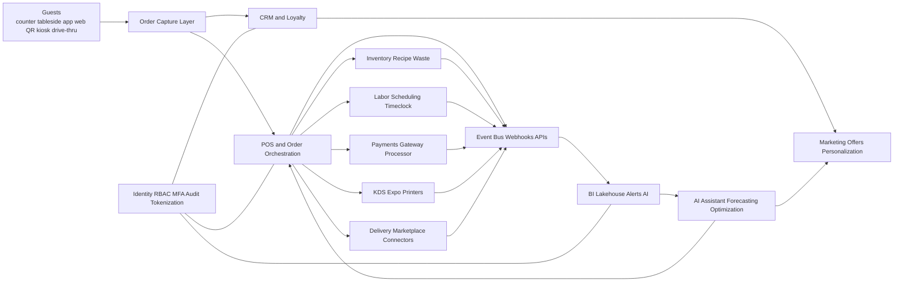
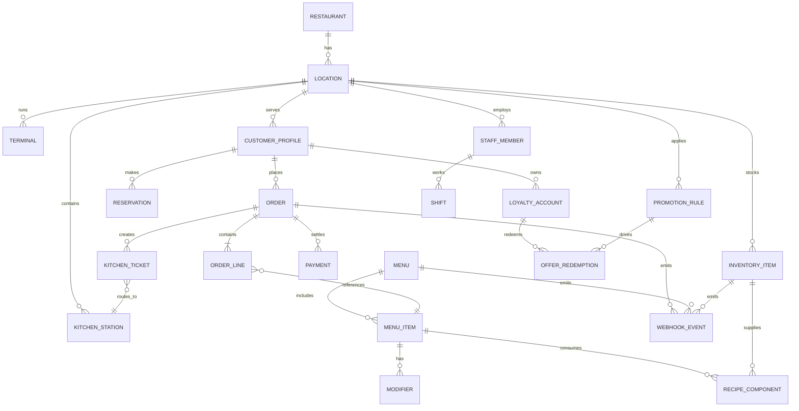
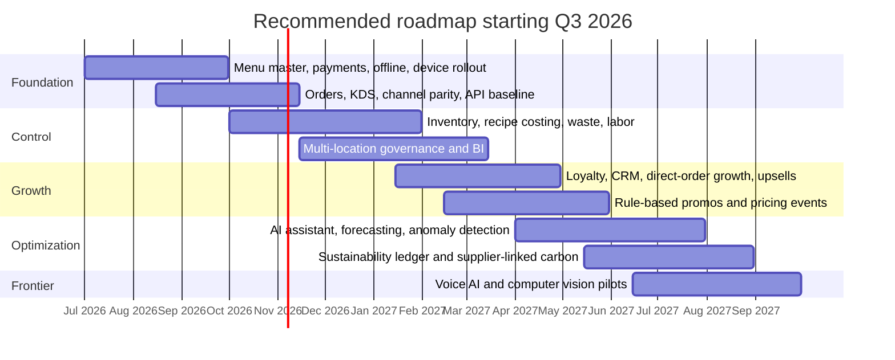

# Industry-Leading Restaurant POS Software Features for 2026

## Executive summary

Restaurant POS in 2026 is no longer just a checkout application. The strongest platforms now behave as a restaurant operating system: they unify payments, order capture across channels, kitchen execution, labor and inventory control, guest data, analytics, and increasingly AI-assisted decision support. The mature, high-confidence feature set for 2026 is cloud-first, API-driven, offline-resilient, and centered on a single operational data model that keeps menus, prices, availability, and customer identity synchronized across terminals, handhelds, kiosks, QR ordering, web/app ordering, and delivery channels. This direction is well aligned with current operator and consumer demand: the National Restaurant Association found that convenience-enhancing smartphone, web/app ordering, and digital/contactless payment options were especially important to consumers, while its 2026 industry outlook highlights digital ordering, automation, and data analytics as major priorities under cost pressure. citeturn12view0turn12view2

The next layer of differentiation in 2026 is not “having AI” in general, but deploying narrowly useful AI inside the operating workflow: AI assistants that answer questions and take actions, forecasting that improves staffing and prep, upsell recommendations, anomaly detection, and location-comparison copilots. Deloitte’s 2025 survey of 375 restaurant executives in 11 countries found that eight in 10 expected AI spending to increase in the next fiscal year, with customer experience and inventory management already generating economic value; official vendor releases from Toast, Oracle, PAR, SpotOn, and Lightspeed show that this has translated into embedded assistants, pricing insights, menu automation, and AI-driven coaching rather than speculative general-purpose automation. citeturn12view1turn9search0turn29view0turn26view0turn24view3turn24view1

The most important architectural conclusion is that “industry-leading” in 2026 depends less on the POS screen itself and more on the control plane around it: real-time webhooks and APIs for menus, orders, stock, payments, and locations; secure event transport; centralized identity and role management; tokenized payments; reliable offline continuation; and a data layer that can feed CRM, loyalty, BI, loss prevention, sustainability, and AI services. Toast, Square, Oracle Simphony, NCR Voyix, and Revel all publicly document event/webhook or API-based synchronization models, which is now table stakes for serious restaurant stacks. citeturn27view0turn27view1turn27view3turn28view0turn28view1turn29view2turn30search2turn5search8turn5search7

The main caution area is “emerging” functionality. Voice AI ordering, computer vision, dynamic pricing, and carbon accounting are real and increasingly relevant, but they are not universal must-haves. In 2026, voice AI is most defensible for QSR drive-thru and phone ordering; computer vision is strongest in drive-thru timing, queue analytics, prep management, and shrink/loss-prevention use cases; dynamic pricing is best implemented as bounded, rules-based price lists and off-peak/promotion logic rather than opaque surge pricing; and sustainability tracking is most practical when it starts with waste logging, recipe costing, and supplier-linked carbon data rather than top-down ESG dashboards alone. citeturn11search8turn11search5turn36search1turn36search2turn10search5turn35search12turn35search15turn17search1turn18search0turn37view0

For a typical 2026 deployment, the recommended minimum viable stack is: integrated payments; synchronized menu and item availability across in-store and first-party digital channels; kitchen display/routing; basic inventory and food-cost tracking; schedule/timeclock/labor reporting; guest profiles with gift cards or loyalty; real-time reporting; APIs/webhooks; and security/offline controls. The recommended industry-leading stack adds omnichannel order orchestration, enterprise menu governance, personalized offers and upsells, forecast-based labor and prep, franchise dashboards, action-taking AI assistants, sustainability tracking, and—where the concept justifies it—voice AI, kiosks, and computer vision. citeturn28view3turn20view2turn29view4turn26view2turn24view2turn24view3

## Market context and what defines leadership in 2026

The strongest evidence from current industry research is that restaurant technology investment is being shaped by a combined pressure set: consumers still want convenience and speed, operators still need labor and margin control, and enterprise brands increasingly need multi-location governance rather than just local-store features. The National Restaurant Association’s 2024 technology research shows that full-service guests still value human interaction, but many would use technology for ordering or payment; limited-service customers are even more receptive to app-based ordering and payment. Its 2026 industry outlook then places “tech improvements” in digital ordering, automation, and analytics squarely inside the productivity agenda. citeturn12view0turn12view2

A leading POS platform in 2026 therefore has five defining traits. First, it is channel-native: orders from counter, tableside, web, branded app, kiosk, QR, and delivery partners land in one operational model. Second, it is back-of-house aware: stock, recipe, labor, prep, and routing are not treated as bolt-ons. Third, it is extensible: APIs, webhooks, and marketplace integrations are mature enough to support best-of-breed ecosystems. Fourth, it is resilient: offline capability and sync recovery are explicit, documented product functions. Fifth, it uses AI selectively where data and workflow maturity already exist. These traits are visible across official product documentation from Square, Toast, Oracle Simphony, NCR Voyix, PAR, Lightspeed, SpotOn, Revel, and Shift4. citeturn28view2turn23view3turn29view4turn30search3turn25search5turn20view2turn9search3turn13search2turn20view4

That definition also explains why the market has converged around a smaller number of high-value workflows. Mature workflows include integrated payments, mobile and online ordering, KDS, direct-channel growth, loyalty, labor visibility, and API-led integrations. Emerging workflows include AI assistants, dynamic pricing rules, computer vision, and carbon-footprint-aware menu management. In Deloitte’s AI study, customer experience and inventory were already yielding value, while broader AI deployment was still constrained by readiness, governance, technical skills, and compliance concerns. That is consistent with vendor reality in 2025–2026: assistants and forecasting are mainstreaming; fully autonomous decisions are not. citeturn12view1turn9search0turn29view0turn26view0turn24view3

## Feature analysis matrix

The matrix below synthesizes official vendor documentation, standards, and recent industry research. The business-value, technical-design, and complexity judgments are analytical inferences grounded in those sources; vendor examples and documented evidence are cited directly.

| Feature family | What industry-leading looks like in 2026 | Business value | Technical requirements and typical data flow | Implementation complexity | Privacy, security, and integration considerations | Representative vendor examples 2024–2026 | KPIs |
|---|---|---|---|---|---|---|---|
| Payments, contactless, QR, mobile checkout | Unified card-present and card-not-present stack; NFC wallets; pay-at-table; Tap to Pay on phone; QR pay on receipt or table; tokenized settlement; support for tips, pre-auth, surcharging/dual pricing where lawful | Faster throughput, higher conversion, lower checkout friction, fewer terminal handoffs, improved guest satisfaction | `POS/handheld/app -> payment gateway/processor -> token/vault -> settlement -> ledger/reporting`; device certification, network redundancy, tokenization, tip and refund workflows | Medium | PCI DSS scope reduction, tokenization, EMV/NFC and QR handling, dispute controls, offline-payment risk, signature verification where webhooks are used | Square Tap to Pay on iPhone/Android; Aloha Mobile Pay QR and SMS links; revel QR order/pay; Clover QR order & pay; Shift4 Dine QR/mobile; Oracle mobile order and pay. citeturn19search1turn19search5turn30search1turn13search2turn21view4turn20view4turn29view4turn15search3turn15search12 | Payment success rate, authorization rate, average checkout time, % contactless, tip rate, chargeback rate, queue abandonment |
| Digital ordering, kiosk, tableside, app/web, channel orchestration | One menu and one availability model across counter, handhelds, kiosks, QR/table ordering, website, app, and delivery marketplaces; direct ordering prioritized over tablet farms | Revenue growth, direct-order mix, fewer re-key errors, faster service, better menu control | `Menu master -> channels -> order orchestration -> POS -> KDS -> guest notifications`; menu/metadata sync, stock status, channel mapping, digital menu images and modifiers | Medium to High | Menu parity, cancellation/refund handling, guest identity resolution, order throttling, channel attribution, commission leakage prevention | Square organizes in-house, online, delivery partner, and QR orders from one screen; Oracle supports ordering widget, DSP integrations, kiosks, and cloud-kitchen/virtual-brand growth; SpotOn and Shift4 emphasize commission-free/direct ordering; Toast documents near-real-time menu sync and stock webhooks. citeturn28view2turn29view4turn24view3turn20view4turn27view1turn27view2turn27view3 | Direct digital mix, order error rate, channel contribution margin, average order value, marketplace commission %, menu sync latency |
| Kitchen operations, KDS, routing, expo, ghost-kitchen support | Item-level routing, course/seat/expo views, one-behind or staged routing, prep-time reporting, ghost-kitchen order segmentation, unified kitchen visibility | Lower remake rates, better ticket clarity, faster ticket times, improved throughput under peak load | `Order -> routing rules -> KDS/expo/printer -> completion events -> reporting`; printer/KDS failover, item tags, prep station mapping, dine-in/takeout differentiation | Medium | Kitchen event logs should feed analytics; need resilient local networking; ghost kitchens need order source tagging and packaging logic | PAR KDS, Clover KDS with item routing and expo mode, Aloha Cloud one-behind routing in 2026, Square KDS, Toast KDS/menu availability sync, Lightspeed’s 2026 KDS improvements. citeturn25search6turn33search6turn30search8turn28view2turn27view3turn24view1 | Ticket time, expo time, remake/void rate, on-time fulfillment %, station bottleneck minutes |
| Inventory, recipe costing, purchasing, waste, sustainability tracking | Ingredient-level depletion, recipe and prep yields, receiving and vendor orders, waste reasons, food-cost reporting, and increasingly supplier-/recipe-linked carbon or climate data | Better margins, fewer stockouts, less spoilage, improved prep planning, measurable waste reduction | `Sales/order mix -> ingredient depletion -> inventory ledger -> purchasing/waste -> BI/sustainability`; recipe master, units-of-measure, variance handling, supplier catalog | Medium to High | Supplier data quality is critical; sustainability layers need provenance and LCA assumptions; privacy risk is lower than CRM but supplier/commercial sensitivity remains | Toast Inventory and Food Waste Tracker; PAR OPS inventory/loss-prevention/recovery; Lightspeed advanced inventory and wastage tracking; PreciTaste demand forecasting and prep optimization; Eaternity menu carbon calculations. citeturn17search1turn17search5turn25search5turn26view3turn17search4turn20view2turn36search15turn18search0turn37view0 | Food cost %, stockout rate, waste value, inventory variance, purchasing cycle time, CO2e per menu item or menu mix where tracked |
| Labor, scheduling, payroll, tips, compliance | POS-linked scheduling, timeclock, break/overtime visibility, tip pooling/distribution, punch verification, store-to-store staffing, forecast-guided staffing, compliance alerts | Lower labor cost %, fewer overtime surprises, better staffing coverage, smoother payroll prep | `Sales forecast + labor rules -> schedules/time punches -> payroll/tips -> compliance reporting`; role mapping, shift templates, wage/tip rules, app-based employee access | Medium | Labor-law compliance is jurisdiction-specific; RBAC protects employee data; payroll integrations require high data accuracy and retention controls | PAR OPS Workforce; Square Team Management; SpotOn Teamwork; Toast Scheduling/Payroll; Oracle labor-management integration support. citeturn26view3turn28view3turn32search0turn32search12turn23view3turn29view1turn36search6 | Labor %, sales per labor hour, overtime hours, schedule adherence, no-show rate, payroll-prep time |
| Analytics, reporting, benchmarking | Near-real-time dashboards for sales, labor, menu, kitchen, and guest behavior; location rollups; benchmark comparisons; natural-language querying where available | Faster decisions, earlier margin-drift detection, better cross-location standardization | `POS/KDS/payments/inventory/labor/events -> data platform/BI -> dashboards/alerts/AI`; event transport, normalized location/menu IDs, historical retention | Medium | Separate operational and analytics planes; data lineage and role-based access matter; location and menu master data are prerequisites | Oracle BI API for near-real-time cloud access; PAR OPS Coach/Coach AI; Toast cross-location AI insights; SpotOn real-time reporting and Profit Assist; Square Reporting API beta. citeturn29view2turn26view2turn24view2turn9search3turn9search11turn28view0 | Report freshness, time-to-insight, manager adoption, margin variance detected early, same-store sales comparability |
| CRM, loyalty, marketing, personalization | Persistent guest profiles, rewards, offers, segmented campaigns, visit and order history, guest notes/preferences, app or wallet-based identity, omnichannel redemption | Higher repeat rate, larger baskets, lower CAC, better first-party data quality | `POS/web/app/payment identity -> customer profile/CDP -> loyalty/offer engine -> campaign channels -> redemption back to POS`; customer identity graph, consent capture, offer rules | Medium | This is the most privacy-sensitive domain after payments; consent, data minimization, deletion/access workflows, and cross-location profile governance matter | Toast Guest CRM and loyalty migration tools; Oracle CrowdTwist 360-degree profiles and Simphony integration; PAR Engagement/Punchh; Square Loyalty integrates with Marketing; SpotOn mobile reservations/order ecosystem keeps guest data with the restaurant. citeturn34search13turn34search5turn34search17turn34search3turn34search11turn25search0turn25search23turn34search8turn24view3 | Repeat visit rate, active loyalty members, redemption rate, guest lifetime value, opt-in rate, campaign ROI |
| Dynamic pricing, promotions, revenue optimization | Rules-based price lists, scheduled pricing, happy-hour logic, order-type fees, targeted offers and upsells; not uncontrolled “surge pricing” | Better mix shift, off-peak demand shaping, margin recovery on order-type costs, higher check average | `Menu items/order profiles/time rules/customer segments -> pricing/offer engine -> POS/channels -> analytics`; needs strong menu governance and explainable rules | Medium to High | Fairness and transparency matter; price display consistency is critical; avoid brand damage from opaque or excessively volatile pricing | Lightspeed order-profile-linked price lists and 2026 pricing insights; SpotOn order-type fees and pricing events; Toast Menu Upsells and Toast IQ price/availability updates; Square’s guidance frames dynamic pricing as prices moving up or down with demand. citeturn35search12turn35search0turn35search15turn35search3turn35search1turn24view2turn10search5 | Check average, promo redemption lift, margin after promo, off-peak traffic, price override rate |
| Cloud, offline resilience, deployment options | SaaS/cloud management, documented offline mode, local failover or hybrid redundancy for high-dependability environments, device-agnostic management | Less downtime, easier remote administration, lower server burden, faster rollouts | `Local devices/store network <-> cloud services`; sync queues, retry logic, local cache, offline authorization and reconciliation, cellular backup where available | Medium | Offline card acceptance adds risk; sync conflict handling and audit trails are essential; enterprise brands may still require hybrid/on-prem options | Square offline payments up to 24 hours; SpotOn blackout-proof offline mode; Toast documents offline mode and network requirements; Lightspeed advertises offline mode; Revel Always On; Oracle supports cloud-based and on-prem deployments; NCR positions Aloha Essentials as cloud benefits with onsite redundancy. citeturn28view3turn32search15turn23view3turn20view2turn31search0turn31search2turn31search13turn31search3 | Uptime, offline incident recovery time, sync error rate, payment recovery rate, configuration lead time |
| Integrations, APIs, webhooks, data platform | Open developer program, menu/order/stock/customer APIs, webhook/event system, marketplace, CDC-ready exports, integration testing and sandbox support | Lower lock-in, faster partner rollout, better data reuse, easier franchise and enterprise governance | `Core POS data -> APIs/webhooks/exports -> partner apps/data warehouse/AI`; needs canonical IDs, auth, versioning, idempotency, retry policies | High | Webhook signatures, API rate limits, payload sizing, version control, vendor governance, marketplace review and support SLAs are essential | Toast orders/menus/stock webhooks; Square 20+ APIs and real-time webhooks; Oracle STSG2/BI APIs and 200+ partners; NCR Data Sharing/API-enabled exports and In-Store Order API; Revel webhooks/callbacks; Shift4 and Clover developer ecosystems. citeturn27view0turn27view1turn27view3turn28view0turn28view1turn29view2turn29view4turn30search2turn8search2turn5search8turn5search7turn33search0turn33search4turn33search12 | Integration lead time, failed webhook rate, API latency, version-break incidents, % workflows automated |
| Security, privacy, compliance, accessibility | Tokenized payments, RBAC/MFA, immutable audit trails, encrypted transport, signed events, privacy rights workflows, accessibility support, nutrition/allergen and tax/fiscal configurability | Risk reduction, easier audits, lower breach probability, broader market access, fewer regulatory surprises | Security overlays every other feature; identity plane, log pipeline, key management, vulnerability management, data-retention/deletion workflows | Medium to High | PCI DSS 4.0.1 for payment environments; NIST CSF 2.0 for cyber program design; NIST AI RMF for AI features; GDPR/CCPA for consumer data rights; WCAG 2.2 for digital accessibility; menu/allergen/nutrition compliance must be configurable by jurisdiction | Standards and regulatory baselines rather than vendor-specific “extras.” citeturn15search12turn15search4turn15search5turn15search2turn16search0turn16search1turn16search2turn16search11turn16search3 | PCI scope, security incident count, failed-login anomalies, time to revoke access, DSAR turnaround time, accessibility defect backlog |
| AI copilots, voice AI, computer vision | Embedded assistant for Q&A and actions, forecast-driven prep/staffing, menu automation, phone/drive-thru voice ordering, camera-based queue/prep/drive-thru intelligence | Higher manager productivity, better forecasting, better attach rate, lower missed-call volume, more consistent drive-thru/BOH execution | `Operational data lake/event stream -> models/agent layer -> recommendations or actions -> POS/CRM/labor/kitchen`; requires clean master data, permissions, feedback loops, model monitoring | High | AI needs governance, explainability, approval boundaries, privacy reviews for voice/video, and human override; strongest ROI is in narrowly scoped use cases | Toast IQ; Oracle Simphony Smart Assistant; PAR AI/Coach AI; SpotOn Profit Assist and AI Menu Assistant; Lightspeed AI/Tempo; Presto Voice, SoundHound Smart Ordering, Hellometer CV, PreciTaste kitchen AI. citeturn9search0turn24view2turn29view0turn26view0turn26view2turn24view3turn9search11turn20view2turn11search8turn11search5turn36search1turn36search2turn36search15turn15search2 | Manager time saved, forecast accuracy, upsell acceptance, missed-call rate, drive-thru throughput, variance-to-plan in prep |
| Multi-location, franchise management, hardware, pricing models | Centralized menu and pricing governance, template rollout, cross-store dashboards, company/site/register hierarchy, rugged handhelds, kiosks, customer-facing displays, subscription- and quote-led pricing mix | Better rollout speed, stronger brand consistency, easier franchisor/franchisee oversight, right-sized capex/opex | `Corporate config -> store/location objects -> terminals/handhelds/kiosks`; governance workflows, staged rollout, remote device management | Medium to High | Need separation between corporate and store-level access; hardware lifecycle and payment lock-in matter; pricing often mixes software, hardware, implementation, and processing | Toast multi-location and hardware; Lightspeed multi-location, tableside, KDS, public plan tiers; Oracle global and $1 hardware options; NCR multi-site management and monthly all-in-one subscriptions; PAR OPS is modular and quote-led for 20+ locations; SpotOn, Square, and Shift4 publish SMB/midmarket pricing. citeturn23view3turn20view2turn19search7turn29view4turn13search3turn30search3turn30search7turn26view1turn26view3turn20view3turn22view1turn20view4 | Rollout time per location, menu-change propagation time, device uptime, first-year TCO, help-desk tickets per store |

## Architecture, data flows, and control-plane design for 2026

A 2026 restaurant stack should be designed as an event-driven operating platform, not a collection of point tools. The practical reason is that modern restaurant workflows are time-sensitive and cross-domain: an item marked out of stock must instantly affect kiosks, apps, delivery menus, and KDS routing; a guest offer redemption must update the CRM, loyalty balance, check detail, and campaign attribution; a labor variance alert must be joinable against sales and guest demand. Toast’s orders, menus, and stock webhooks; Square’s realtime webhooks; Oracle’s BI and transactional APIs; NCR’s data-sharing exports; and Revel’s webhooks/callbacks all point toward the same architectural model. citeturn27view0turn27view1turn27view3turn28view1turn29view2turn30search2turn5search8turn5search7

For most operators, the right implementation pattern is a hub-and-spoke core. The POS/order service should remain the system of transactional record. Payments should be tokenized and isolated. CRM/loyalty should either be natively integrated or fed by a clean event stream rather than nightly CSVs. The BI layer should receive normalized events from POS, KDS, payments, labor, and inventory rather than scraping reports. This design is also the easiest path to AI because it creates consistent, queryable operational context. Oracle’s BI API, Square’s Reporting API beta, PAR Coach AI, and Toast IQ’s cross-location analysis all depend on that kind of normalized data foundation. citeturn29view2turn28view0turn26view2turn24view2

Security and compliance should be treated as architecture, not policy paperwork. Payment environments should be designed to the PCI DSS baseline; cybersecurity governance should map cleanly to NIST CSF 2.0; AI features should adopt a lightweight AI-RMF-style governance model; customer-data handling should be configurable for privacy-rights regimes such as GDPR and CCPA; digital touchpoints should be built toward WCAG 2.2; and menu systems should be able to carry nutrition and allergen information for jurisdictions where disclosure is required. Because the region is unspecified, the safest design principle is a configurable compliance layer: data retention, consent, surcharge rules, tax handling, menu labeling, and access controls should all be policy-driven rather than hard-coded to one country. citeturn15search12turn15search5turn15search2turn16search0turn16search1turn16search2turn16search11turn16search3

## Prioritization by restaurant type and size, and vendor landscape

The service-model and size matrices below are analytical priorities inferred from NRA consumer preferences by segment, vendor segment positioning, and the observed maturity of feature families in 2025–2026. They should be read as implementation priority, not universal truth. citeturn12view0turn23view3turn29view0turn26view2turn28view3

**Legend:** **E** = essential in 2026, **H** = high priority, **A** = advantageous/emerging, **L** = lower relative priority.

| Feature family | Quick service | Fast casual | Full service | Bars | Ghost kitchens |
|---|---:|---:|---:|---:|---:|
| Integrated payments/contactless/mobile | E | E | E | E | H |
| First-party digital ordering | E | E | H | M | E |
| KDS/routing/expo | E | E | H | M | E |
| Inventory/food cost/waste | H | H | E | E | H |
| Labor/scheduling/compliance | E | E | E | E | H |
| Reservations/tableside/pay-at-table | L | M | E | H | L |
| Loyalty/CRM/personalization | H | H | H | H | M |
| Kiosk/QR self-service | E | H | M | M | L |
| Drive-thru/voice/CV | E for drive-thru concepts | M | L | L | L |
| Delivery/aggregator orchestration | H | H | M | M | E |
| Multi-location governance | H | H | H | H | H |
| Sustainability/carbon tracking | M | M | H | M | M |

| Feature family | Single location | Multi-location group | Enterprise/franchise |
|---|---:|---:|---:|
| Core POS + payments + KDS | E | E | E |
| Cloud/offline resilience | E | E | E |
| Basic inventory + labor | H | E | E |
| CRM/loyalty/marketing | H | H | E |
| APIs/webhooks/data platform | M | H | E |
| Franchise/location governance | L | H | E |
| AI assistant/forecasting | M | H | E |
| Dynamic pricing/promotions engine | M | H | H |
| Computer vision / advanced drive-thru | L | M | H where relevant |
| Sustainability ledger/carbon | L | M | H |

### Vendor comparison of top platforms

**Legend:** **Strong** = clearly documented/native strength, **Good** = supported or well-positioned, **Partial** = add-on/partner-dependent or narrower, **Quote-led** = typically custom-scoped.

| Vendor | Best fit | Payments / contactless / QR | Ordering / KDS / handhelds | Inventory / labor | CRM / loyalty / marketing | APIs / integrations | AI / automation | Offline / deployment | Pricing model and notes |
|---|---|---|---|---|---|---|---|---|---|
| Toast | Broad U.S. restaurant market; especially FSR, QSR, fast casual, multi-unit | Strong | Strong | Good to Strong | Strong | Strong | Strong | Good | Public pricing page plus quote mix; broad suite including handhelds, kiosks, KDS, payroll, CRM, delivery, APIs, multi-location, and Toast IQ. citeturn23view3turn24view2turn27view0turn27view1turn27view3turn9search0 |
| Square for Restaurants | SMB to midmarket; easy start for single to multi-location | Strong | Strong | Good | Good | Strong | Emerging | Good | Transparent public plans plus custom Premium; strong developer platform, offline payments, KDS/kiosk add-ons, multi-location stock on paid tiers. citeturn28view3turn22view1turn22view2turn28view0turn28view1turn28view2 |
| Lightspeed Restaurant | Hospitality-focused SMB to enterprise, especially table service and bars | Strong | Strong | Strong | Good via native + integrations | Good | Emerging to Strong | Good | Transparent plans from Starter to Enterprise; notable strengths in tableside, bar mode, reservations, tasks, insights, AI, and offline mode. citeturn20view2turn19search7turn24view1turn24view0 |
| Oracle Simphony | Enterprise, global, franchise, hospitality-heavy environments | Strong | Strong | Strong | Strong | Strong | Emerging to Strong | Strong | Quote-led; strongest public evidence on global scale, open APIs, BI, kiosks, loyalty, labor-management integrations, on-prem + cloud support. citeturn29view4turn29view2turn29view1turn29view0turn31search2turn31search13 |
| NCR Voyix Aloha Cloud / Essentials | Independents to emerging chains; stronger hybrid option for higher resilience | Strong | Good to Strong | Good | Good | Good | Emerging | Strong | Mostly quote-led/monthly all-in-one; strengths include multi-site management, QR/text mobile pay, loyalty, data sharing, and onsite redundancy through Essentials. citeturn30search3turn30search1turn30search6turn30search2turn31search3turn30search8 |
| PAR POS + OPS + Engagement | Multi-unit, franchise, enterprise brands | Strong | Strong | Strong | Strong | Strong | Strong | Good | Quote-led and modular; especially strong for franchise operations, labor/inventory, loyalty/engagement, partner ecosystem, and AI coaching. citeturn26view1turn26view2turn26view3turn25search5turn25search23turn26view0 |
| SpotOn Restaurant | Independent restaurants and regional groups; strong operator-oriented value proposition | Strong | Strong | Good to Strong | Good | Good | Strong | Strong | Transparent SMB pricing plus bundled options; strengths in ordering, scheduling, reporting, offline mode, AI P&L analysis, AI menu updates, and order-type fee controls. citeturn14search9turn20view3turn24view3turn32search0turn32search15turn9search11 |
| Shift4 Dine | Cost-sensitive operators wanting all-in-one features | Strong | Good to Strong | Partial to Good | Good | Good | Partial | Good | Very transparent low-cost positioning; includes QR, loyalty, reservations/waitlist, online ordering, handhelds, and marketplace integrations. citeturn20view4turn33search1turn33search3turn33search20 |

The practical vendor takeaway is straightforward. If the goal is quick deployment, moderate customization, and transparent pricing, Square, Lightspeed, SpotOn, and Shift4 are especially compelling. If the goal is a restaurant-native all-in platform with strong multiple-location coverage and rapidly expanding AI features, Toast is difficult to ignore. If the goal is global enterprise flexibility, hybrid deployment options, or franchise-grade control planes, Oracle Simphony, NCR Aloha, and PAR are the most strategically complete choices. citeturn22view1turn20view2turn20view3turn20view4turn24view2turn29view4turn31search3turn26view1

## Recommended minimum viable stack, industry-leading stack, and phased roadmap

The recommended **minimum viable 2026 feature set** is the smallest stack that still looks current rather than dated. It should include integrated card and wallet payments; web/app ordering with synchronous menu and stock status; kitchen display and routing; basic ingredient/recipe or at least item-level stock and 86ing; timeclock, scheduling, and labor reporting; guest profiles plus gift cards or loyalty; real-time item mix and sales dashboards; documented offline mode; and webhooks/APIs for orders, menus, and stock. Without that combination, restaurants increasingly end up with channel fragmentation, manual reconciliation, or blind spots in labor and margin control. citeturn12view0turn27view0turn27view1turn27view3turn28view3turn20view2

The recommended **industry-leading 2026 feature set** adds four layers. The first is **orchestration**: kiosks, QR/table ordering, tableside, and marketplace flows all managed from one menu and availability model. The second is **control**: ingredient-level costing and waste, forecast-based staffing, enterprise menu governance, and cross-location dashboards. The third is **engagement**: CRM, loyalty, personalized offers, and upsells deployed across handhelds, kiosks, guest-facing displays, and digital channels. The fourth is **optimization**: action-taking AI assistants, explainable pricing/promo rules, sustainability tracking, and selective voice/computer-vision automation where the service model justifies the added complexity. citeturn29view4turn26view3turn24view2turn34search3turn25search0turn35search1turn26view0turn36search2

A practical way to deploy this is a phased roadmap beginning with transaction integrity and data hygiene, then layering operational control, then closing the loop with AI and personalization. That sequencing matters because AI, dynamic pricing, sustainability dashboards, and computer vision all degrade quickly when the menu master, location hierarchy, customer identity, or event pipeline are messy. Deloitte’s survey results on readiness gaps strongly reinforce this sequencing. citeturn12view1

### Indicative effort and cost ranges

These are planning ranges, not market averages. They are synthesized from public SMB/midmarket pricing from Square, Lightspeed, SpotOn, and Shift4; public evidence of enterprise quote-led models from Oracle, PAR, and NCR; and the hardware-plus-software bundling patterns shown in official pricing pages. citeturn22view1turn20view2turn20view3turn20view4turn29view4turn26view3turn30search7

| Phase | Typical scope | Effort | Cost range |
|---|---|---|---|
| Foundation | Replace/modernize POS, payments, KDS, menu sync, offline setup, basic web ordering | **Medium** for single site; **High** for migration-heavy groups | **Low to Medium** for SMB; **Medium** for multi-unit |
| Control | Inventory, recipe costing, purchasing, labor, reporting, store hierarchy cleanup | **Medium** | **Medium** |
| Growth | Loyalty, CRM, guest data, campaign tooling, kiosk/QR/table ordering | **Medium** | **Medium** |
| Optimization | AI assistant, forecasting, benchmark dashboards, advanced promo engine, sustainability | **High** | **Medium to High** |
| Frontier | Voice AI, computer vision, advanced personalization or dynamic pricing pilots | **High** | **High** |

For budgeting discipline, the simplest heuristic is this. **Low** means largely configuration-led SaaS deployment with minimal custom integration. **Medium** means a cross-workflow rollout involving data migration, hardware refresh, and some integration work. **High** means enterprise-grade change: franchise governance, custom APIs, data-platform work, multiple operational domains, or frontier automation like voice/video AI. Public pricing pages show that this spread is real: Square starts at $0/$49/$149 per location tiers with KDS and kiosk app fees; Lightspeed publishes $69/$189/$399 tiers plus per-screen KDS pricing; SpotOn publishes $0 and $55-per-station options with hardware and implementation costs; Shift4 Dine advertises a $29.99/month entry point; enterprise vendors such as Oracle, PAR, and NCR predominantly sell custom-scoped packages. citeturn22view1turn22view2turn20view2turn20view3turn20view4turn29view4turn26view3turn30search7

### Open questions and limitations

Because the region was left unspecified, this report intentionally emphasizes globally portable design principles rather than local tax, fiscalization, data-residency, alcohol, labor, or menu-labeling specifics. Those requirements can materially change vendor fit and rollout scope. Public vendor documentation also varies in depth: some platforms expose detailed API/offline behavior, while others market capabilities more broadly than they document them. Finally, AI, voice, and computer-vision capabilities are evolving quickly; late-2026 vendor packaging may change faster than core POS, payments, or KDS capabilities. citeturn15search12turn16search0turn16search1turn16search2