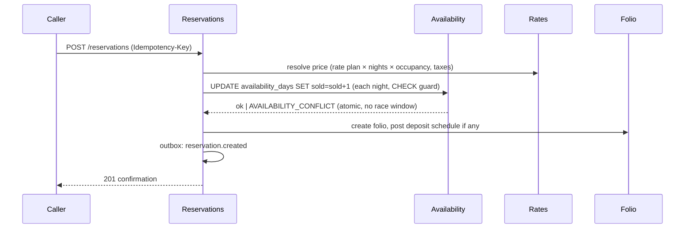

# Module 01 — PMS Core (Reservations · Front Desk · Folios · Rates · Availability)

> The revenue core. Everything else in the platform orbits these workflows. Spec covers Reservations, Check-in/out, Room assignment & transfers, Groups & corporate, Walk-ins, Folios/Charges/Payments/Refunds, Taxes, Room inventory & status, Rate plans, Packages, Availability.

---

## Purpose

Run the complete guest-stay revenue lifecycle — quote → book → arrive → stay → settle → depart → audit — as a single transactional domain with zero hand-offs between "systems."

## Features

**Reservations:** individual/multi-room/multi-rate bookings; flexible stay units (nightly; day-use; long-stay monthly for serviced apartments); shares (multiple guests per room with split billing); waitlists; tentative holds with TTL; cut-off dates; guarantee policies (hold, card guarantee, deposit, prepaid); cancellation policies with automated fee posting; reinstatement; itinerary view across properties (chain guests).

**Front desk:** arrivals/departures/in-house boards; room rack (interactive grid: rooms × dates); express + mobile + kiosk check-in; ID/registration-card capture (e-signature); key-encoder integration hooks; queue rooms (arrival before room ready → HK priority bump); check-out with folio settle, email folio, late-checkout fees; end-of-shift cashier close.

**Rooms & inventory:** room types with attributes (bedding, view, floor, accessibility, connecting) enabling future attribute-based selling; physical rooms; virtual/component rooms (suite = 2 connecting physicals — both blocked when suite sells); out-of-order (removes from inventory) vs out-of-service (sellable, flagged); room status lifecycle (`dirty → clean → inspected` × `vacant/occupied`) synced live with Housekeeping.

**Rates:** rate plans (BAR, corporate negotiated, package, member, FIT/wholesale) with derivation (e.g. CORP = BAR −10%, follows BAR automatically); daily prices per room type with per-occupancy pricing (single/double/extra adult/child); restrictions (MinLOS/MaxLOS, CTA/CTD, stop-sell) at rate×roomtype×date granularity; packages (rate + bundled posting-rhythm items: breakfast daily, spa once); promo codes; best-available-rate resolution in one indexed query; full price history.

**Taxes & fees:** tax rules per charge code (VAT inclusive/exclusive, US occupancy tax, city/tourist tax per-person-per-night with age bands, service charge), effective-dated, jurisdiction templates; tax exemption handling per reservation/company with certificate reference.

**Folios & payments:** unlimited folios per reservation (guest/company splits); window routing rules (e.g. "room+tax → company folio, incidentals → guest"); paymaster/house accounts; group masters; charge posting (manual, room-plan auto-post at audit, POS room-charge, minibar, phone); transfers between folios; splits; adjustments (reversal + repost, reason-coded); payments (card via PSP token, cash, bank transfer, AR transfer, vouchers, multi-currency with FX snapshot); deposits (pre-arrival, auto-applied at check-in); refunds (tiered permission, partial, to-original-method); pro-forma and fiscal invoices; credit limits with authorization top-ups.

**Night audit (business-date roll):** zero-downtime background process — validates pending arrivals (no-show processing with fee posting), posts room & tax for in-house, reconciles cashiers, locks the business date for posting, generates the daily journal to GL, produces manager flash report, advances `business_date`. Runs per property at its configured roll time; failures alert and are re-runnable per step (idempotent steps).

## Database entities (module-owned)

`reservations`, `reservation_nights`, `reservation_room_stays`, `reservation_guests`, `reservation_status_log`, `group_blocks`, `group_block_inventory`, `room_types`, `rooms`, `room_attributes`, `room_status_log`, `out_of_order_periods`, `availability_days`, `rate_plans`, `rate_prices`, `rate_restrictions`, `packages`, `package_items`, `promo_codes`, `cancellation_policies`, `guarantee_policies`, `folios`, `folio_postings`, `posting_taxes`, `charge_codes`, `tax_rules`, `payments`, `payment_methods`, `deposits`, `cashier_sessions`, `business_dates`, `registration_cards`.

Key schema decisions in [07-database-design.md](../07-database-design.md) (availability counters, nights/room-stays split, immutable postings).

## APIs (representative)

```
GET/POST            /reservations            GET /reservations/{id}
POST                /reservations/{id}/check-in | /check-out | /cancel | /no-show | /reinstate
POST                /reservations/{id}/room-moves          { roomId, effectiveDate, reason }
GET                 /availability?from&to&adults&promoCode  (public-safe variant for booking engine)
GET                 /rate-plans  /rate-plans/{id}/prices?from&to
PUT                 /rate-plans/{id}/prices   (bulk grid update, If-Match)
POST                /group-blocks  /group-blocks/{id}/pickup
GET/POST            /folios   POST /folios/{id}/postings | /payments | /transfers | /split
POST                /payments/{id}/refunds
POST                /night-audit/run      GET /night-audit/status
GET                 /front-desk/arrivals | /departures | /in-house | /room-rack?from&to
```

## Core workflows

### Booking (any source — booking engine, front desk, channel, API)

The counter update **is** the lock — two simultaneous bookings of the last room: one commits, one gets a constraint violation → clean 409. This is the structural overbooking fix.

### Check-in
1. Arrival board → guest (search/scan) → verify ID/reg-card (e-sign) → room auto-suggested (gap-optimizing assigner; preferences; clean+inspected only) or manual from rack → guarantee/card on file verified or captured → key encode hook → status `checked_in`; room `occupied`; folio activated; deposit applied; events fan to HK board and POS (guest now room-chargeable). Target: < 60 seconds, fully keyboard-driven (experience spec: [18-front-desk-experience.md](../18-front-desk-experience.md)).

### Room move
`POST /room-moves` → validates target (clean, type rules, rate delta policy: keep/reprice with manager override) → closes current `room_stay` at effective date, opens new → HK tasks auto-created for both rooms → posting note on folio if rate changes → `room.moved` event (POS sees new room number instantly).

### Walk-in
One screen: room-type grid with *tonight's* sellable + price → guest quick-create (name + phone min) → optional card → check-in immediately. Two minutes, three clicks deep, designed for a queue at the desk.

### Group & corporate
- **Group block:** block inventory per roomtype×date (`blocked` counter) with cutoff; rooming-list import (CSV/API); pickup converts block→sold atomically; master folio with routing (room+tax→master); pickup/wash reporting.
- **Corporate:** company profiles with negotiated rate plans, AR account with credit limit, central-bill vs guest-pay routing presets, production statistics per company (feeds CRM + sales).

### Settlement & refunds
Payments via PSP tokens only (PCI posture, [09-security.md](../09-security.md)). Refund flow: permission tier check (amount conditions) → PSP refund → reversal posting → GL auto-entry → event. Folio close requires zero balance or AR transfer (`ar.manage`).

## Permissions
Module section of the catalog: `reservation.*`, `room.*`, `walkin.create`, `folio.*`, `payment.*`, `deposit.*`, `invoice.*`, `cashier.*`, `rate.*`, `availability.*`, `nightaudit.*` (full list: [06-permission-engine.md](../06-permission-engine.md)).

## Dependencies
Kernel (auth/tenancy/permissions/events/audit) · GL (same-transaction journal postings) · Housekeeping (room status, queue rooms) · CRM (guest profiles) · PSP adapter (payments). Consumed by: Booking Engine, Channel Manager, POS, Revenue AI, BI — all through this module's API/events, never its tables.

## Events
Emits: `reservation.created/modified/cancelled/checked_in/checked_out/no_show`, `room.assigned/moved/status_changed`, `availability.changed`, `rate.price_changed`, `folio.charge_posted/payment_recorded/refunded/closed`, `nightaudit.completed`, `group.block_created/pickup`.
Consumes: `housekeeping.task_completed` (room → clean), `pos.check_closed` (room charge posting), `channel.reservation_received`.

## Future scalability
Attribute-based selling (sell "high-floor king with view" computed from room attributes — schema already attribute-first); per-room-type → per-room pricing; fractional/timeshare ownership; multi-property itineraries with single folio; event/function-space module (banquets, MICE) reusing block + folio machinery.
