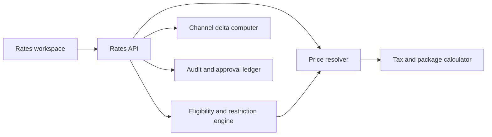

# Module 15 - Rate Plan and Promotion Management

> A revenue manager should be able to answer three questions in one place: who can buy this offer, when can they buy it, and what exactly posts to the folio when they do.

## Competitive Analysis

This design is based on current public documentation from leading hospitality platforms:

- Oracle OPERA Cloud exposes mature enterprise controls for dynamic/base rate derivation, advanced packages, best available rates, rate seasons, rate tiers, promotion codes, rate-code approval, rate floors, suppressed rates, and posting rhythms. The approval model is especially important: unapproved or rejected rate codes are not sellable until reviewed.
  Source: https://docs.oracle.com/en/industries/hospitality/opera-cloud/22.5/ocsuh/c_opera_controls_rate_management.htm and https://docs.oracle.com/en/industries/hospitality/opera-cloud/22.2/ocsuh/t_admin_financial_managing_rate_code_approval.htm
- Cloudbeds centers rate plans around date intervals, accommodation eligibility, booking/stay restrictions, MinLOS, MaxLOS, closed-to-arrival, closed-to-departure, cut-off, last-minute windows, and booking-engine/channel sync. Its advanced channel-rate documentation shows why channel capability awareness and mapping status belong in the rate module rather than in a disconnected channel setup screen.
  Source: https://myfrontdesk.cloudbeds.com/hc/en-us/articles/360046222013-Rate-Plans-and-Packages-Restrictions-Overview and https://myfrontdesk.cloudbeds.com/hc/en-us/articles/360045096394-Advanced-Channel-Rates-How-to-Sync-Rate-Plans-to-Distribution-Channels-OTAs
- SiteMinder promotes unlimited rate plans, promotions, packages, promo codes, channel-specific offers, and flexible restrictions. Its promotion guidance reinforces a practical pattern: create a restricted rate plan and expose it through a promo code or direct booking URL rather than treating the promo code as the full rule engine.
  Source: https://www.siteminder.com/r/hotel-promotions/ and https://www.siteminder.com/increase-room-revenue/

## Product Requirements

**Rate plan core**

- Code, name, description, status, owner, approval state, visibility, currency, source ownership, and version.
- Rate type: BAR, corporate, package, member, wholesale, promotional.
- Pricing model: fixed, derived percent, derived amount, per-occupancy, LOS-tiered, open pricing recommendation.
- Base/derived plan linkage with minimum/maximum rate floors and ceilings.
- Start/end sell dates and start/end stay dates as separate windows.
- Day-of-week applicability and blackout periods.

**Eligibility**

- Room type eligibility.
- Room number eligibility for room-specific offers, owner units, suites, renovation constraints, and VIP holds.
- Channel/source eligibility: direct, booking engine, OTA, GDS, corporate, agent, group.
- Guest/company/segment eligibility: member, corporate profile, market segment, source code, loyalty tier.
- Promotion gates: promo code, private URL token, campaign, voucher, limited-use coupon, inventory threshold.

**Restrictions**

- Minimum and maximum stay.
- CTA, CTD, stop sell, close to stay-through, arrival-day MinLOS, and stay-through MinLOS.
- Booking window controls: advance purchase, last-minute, cut-off.
- Custom stay rules with deterministic evaluation order.
- Conflict detection for overlapping sell/stay windows, duplicate promo codes, incompatible room eligibility, and channel capability gaps.

**Packages and meal plans**

- Meal plan: room only, breakfast, half board, full board, all inclusive.
- Included package items with posting rhythm: nightly, first night, once per stay, every X nights, free-night rhythm.
- Allowance accounting for package profit/loss and under/over consumption.
- Tax handling per package item and routing to folio windows.

**Taxes, fees, and service charges**

- Effective-dated tax/service-charge rules.
- Inclusive/exclusive modes.
- Basis: percent, flat, per night, per person per night, per adult, per child age bucket.
- Jurisdiction, exemption handling, GL account mapping, revenue category mapping, rounding policy, and comp/suppressed-rate handling.

## Target Architecture



The current system already has `rate_plans`, `rate_prices`, and `rate_restrictions`. The next implementation step is to keep those tables as the hot path for price lookup while adding richer configuration tables around them.

## Data Model Roadmap

Add these tables without breaking the existing `rate_prices_lookup` hot path:

- `rate_plan_versions`: immutable version snapshots, status, approval state, changed_by, submitted_at, approved_at, published_at.
- `rate_plan_windows`: sell_start, sell_end, stay_start, stay_end, days_of_week, blackout_ranges.
- `rate_plan_eligibility`: room_type_id, room_id, channel_id, source_code, market_segment, company_id, loyalty_tier.
- `rate_plan_pricing_models`: model, derived_from_plan_id, adjustment_type, adjustment_value, min_rate, max_rate, occupancy_rules, los_tiers.
- `promotion_rules`: promotion_type, promo_code, limited_use_count, per_guest_limit, private_url_token, campaign_id.
- `rate_custom_rules`: ordered deterministic predicates and effects, stored as typed JSON with a registry key, not arbitrary executable code.
- `rate_tax_rules`: tax_code, service_charge_code, basis, value, inclusive, jurisdiction, gl_account_code, effective dates.
- `rate_package_items`: charge_code_id, included_in_rate, allowance_amount, posting_rhythm, meal_plan, tax_profile_id.
- `rate_channel_mappings`: channel_id, external_rate_id, capability flags, sync_status, last_published_at.
- `rate_publish_jobs`: idempotent publish runs, target channels, status, warnings, failure payloads.

## API Roadmap

```
GET  /rate-plans
POST /rate-plans
GET  /rate-plans/{id}
PATCH /rate-plans/{id}
POST /rate-plans/{id}/duplicate
POST /rate-plans/{id}/submit
POST /rate-plans/{id}/approve
POST /rate-plans/{id}/publish
POST /rate-plans/{id}/pause

GET  /rate-plans/{id}/prices?from=&to=&roomTypeId=
PUT  /rate-plans/{id}/prices
PUT  /rate-plans/{id}/restrictions
PUT  /rate-plans/{id}/eligibility
PUT  /rate-plans/{id}/taxes
PUT  /rate-plans/{id}/service-charges
PUT  /rate-plans/{id}/package-items
PUT  /rate-plans/{id}/channels

POST /rate-plans/validate
POST /rate-plans/quote-preview
GET  /rate-publish-jobs/{id}
```

## Component Wiring

The implemented desk route is `apps/web/app/(desk)/rates/page.tsx`.

Recommended split when persistence is added:

- `RatePlansPage`: query orchestration, active plan selection, permission checks.
- `RatePortfolioList`: plan search, status filters, duplicate/create actions.
- `RateKpiStrip`: active, approval, restriction, channel health metrics.
- `RateWorkspaceTabs`: tabs for Plans, Promotions, Rules, Taxes, Channels.
- `RateMatrix`: prices and restrictions by room type and stay date.
- `RatePlanInspector`: editable plan metadata, windows, pricing model, meal plan, eligibility.
- `EligibilitySelector`: room type, room number, segment, source, channel toggles.
- `RuleStackEditor`: ordered custom rules, validation warnings, conflict previews.
- `TaxServiceChargeTable`: tax and fee configuration with GL mapping.
- `ChannelDistributionPanel`: mapping status, capability warnings, publish target selection.
- `PublishBar`: save draft, submit, approve, publish, pause, rollback.

State wiring should move from local React state to TanStack Query mutations backed by the SDK. Every mutation should invalidate `rate-plans`, `rate-prices`, `availability`, `booking-engine-offers`, `distribution-health`, and revenue recommendation queries.

## Validation Rules

- Sell window must intersect or precede stay window according to the promotion type.
- End dates must be greater than or equal to start dates.
- Max stay cannot be lower than min stay.
- Room number eligibility must belong to the selected room types.
- Promo codes must be unique per property for overlapping sell windows.
- Derived rates must not create circular dependencies.
- Rate floor/ceiling must be enforced after all discounts but before tax/service-charge calculation.
- Inclusive tax/service-charge calculations must preserve posted gross revenue and split net/tax accurately.
- Channel publish must fail fast if the target channel does not support a selected restriction or pricing model.

## Implementation Plan

1. **Foundation**
   - Add contracts for full rate plan detail, eligibility, promotion rules, tax/service-charge rules, package items, and publish jobs.
   - Add migrations for the roadmap tables.
   - Extend seed data with promotional, corporate, and package rate plans.

2. **API and domain**
   - Implement CRUD for draft rate-plan configuration.
   - Add versioning and approval state transitions.
   - Implement deterministic validation and conflict detection.
   - Extend `RatesService.resolveStay` to evaluate eligibility, promotions, packages, and tax/service charges before quote response.

3. **UI persistence**
   - Replace local state in `apps/web/app/(desk)/rates/page.tsx` with SDK queries and mutations.
   - Split the current route into reusable components under `apps/web/components/rates`.
   - Add optimistic draft updates, mutation toasts, disabled states, and warning panels.

4. **Distribution**
   - Emit `rate.plan_published`, `rate.restriction_changed`, `rate.tax_rule_changed`, and `promotion.changed`.
   - Extend the channel delta computer to read channel capability flags before publish.
   - Add per-channel publish logs and rollback to the previous approved version.

5. **Revenue integration**
   - Let revenue recommendations target a draft rate-plan version.
   - Add "simulate" and "apply recommendation" flows with guardrail approvals.
   - Track pickup, ADR delta, conversion, and net RevPAR by plan and channel.

6. **Quality gates**
   - Unit tests for rule evaluation order, derived-rate math, LOS tiers, promo conflicts, tax inclusivity, and circular dependency protection.
   - Integration tests for quote preview, booking engine availability, reservation creation, and channel publish.
   - Permission tests for `rate.manage`, `rate.publish`, `promotion.manage`, `package.manage`, and `tax.configure`.
